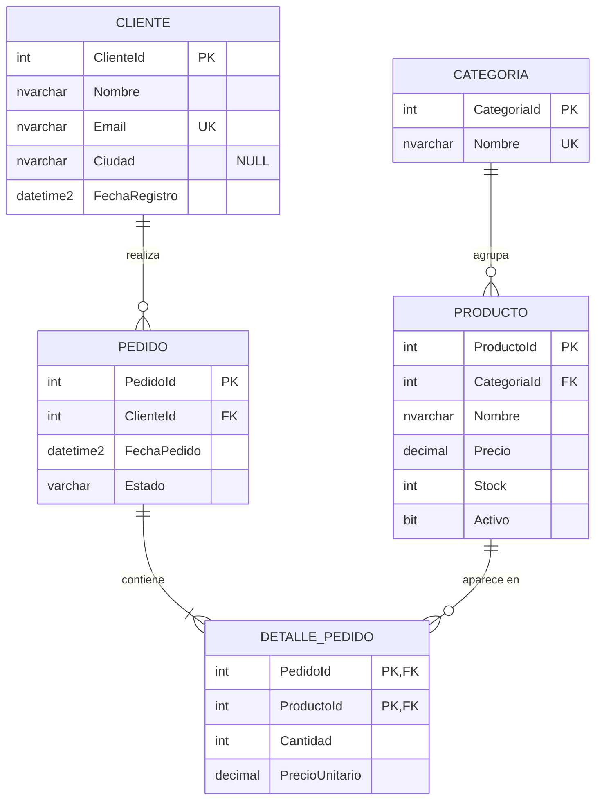

# Esquema de ejemplo: Tienda

Todas las lecciones relacionales usan esta misma base de datos. Es una tienda en línea pequeña: clientes que hacen pedidos de productos organizados en categorías.

El esquema no aparece de la nada: se construye paso a paso en el módulo [Diseño y modelado](02-diseno-y-modelado/README.md), desde los requisitos hasta las tablas normalizadas. Este archivo es el resultado final, listo para ejecutar.

Motor: **SQL Server (T-SQL)**.

-----

## Diagrama



Cómo leerlo: un cliente realiza **cero o muchos** pedidos; un pedido contiene **uno o muchos** detalles; un producto pertenece a **una** categoría. La notación se explica en [Modelo entidad-relación](02-diseno-y-modelado/02-Modelo%20entidad-relación.md).

-----

## Reglas de negocio que refleja

| Regla | Dónde se hace cumplir |
| --- | --- |
| Cada cliente tiene un email único | `UQ_Cliente_Email` |
| Cada producto pertenece a una sola categoría | `FK_Producto_Categoria` + `CategoriaId NOT NULL` |
| No hay dos productos con el mismo nombre en la misma categoría | `UQ_Producto_Categoria_Nombre` |
| El precio y el stock nunca son negativos | `CK_Producto_Precio`, `CK_Producto_Stock` |
| Un pedido pertenece a un cliente que existe | `FK_Pedido_Cliente` |
| El estado del pedido es uno de cinco valores conocidos | `CK_Pedido_Estado` |
| Un producto aparece una sola vez por pedido (con su cantidad) | `PK_DetallePedido (PedidoId, ProductoId)` |
| El pedido guarda el precio que se pagó, aunque el producto cambie de precio después | Columna `DetallePedido.PrecioUnitario` |
| Si se borra un pedido, se borran sus detalles | `ON DELETE CASCADE` en `FK_DetallePedido_Pedido` |
| No se puede borrar un cliente con pedidos | `FK_Pedido_Cliente` sin cascada |

-----

## Script de creación

```sql
CREATE DATABASE Tienda;
GO

USE Tienda;
GO

CREATE TABLE dbo.Cliente (
    ClienteId     INT IDENTITY(1,1) NOT NULL,
    Nombre        NVARCHAR(100)     NOT NULL,
    Email         NVARCHAR(254)     NOT NULL,
    Ciudad        NVARCHAR(80)      NULL,
    FechaRegistro DATETIME2(0)      NOT NULL CONSTRAINT DF_Cliente_FechaRegistro DEFAULT SYSUTCDATETIME(),
    CONSTRAINT PK_Cliente PRIMARY KEY (ClienteId),
    CONSTRAINT UQ_Cliente_Email UNIQUE (Email)
);

CREATE TABLE dbo.Categoria (
    CategoriaId INT IDENTITY(1,1) NOT NULL,
    Nombre      NVARCHAR(50)      NOT NULL,
    CONSTRAINT PK_Categoria PRIMARY KEY (CategoriaId),
    CONSTRAINT UQ_Categoria_Nombre UNIQUE (Nombre)
);

CREATE TABLE dbo.Producto (
    ProductoId  INT IDENTITY(1,1) NOT NULL,
    CategoriaId INT               NOT NULL,
    Nombre      NVARCHAR(100)     NOT NULL,
    Precio      DECIMAL(10,2)     NOT NULL,
    Stock       INT               NOT NULL CONSTRAINT DF_Producto_Stock DEFAULT 0,
    Activo      BIT               NOT NULL CONSTRAINT DF_Producto_Activo DEFAULT 1,
    CONSTRAINT PK_Producto PRIMARY KEY (ProductoId),
    CONSTRAINT FK_Producto_Categoria FOREIGN KEY (CategoriaId) REFERENCES dbo.Categoria (CategoriaId),
    CONSTRAINT UQ_Producto_Categoria_Nombre UNIQUE (CategoriaId, Nombre),
    CONSTRAINT CK_Producto_Precio CHECK (Precio >= 0),
    CONSTRAINT CK_Producto_Stock CHECK (Stock >= 0)
);

CREATE TABLE dbo.Pedido (
    PedidoId    INT IDENTITY(1,1) NOT NULL,
    ClienteId   INT               NOT NULL,
    FechaPedido DATETIME2(0)      NOT NULL CONSTRAINT DF_Pedido_FechaPedido DEFAULT SYSUTCDATETIME(),
    Estado      VARCHAR(20)       NOT NULL CONSTRAINT DF_Pedido_Estado DEFAULT 'Pendiente',
    CONSTRAINT PK_Pedido PRIMARY KEY (PedidoId),
    CONSTRAINT FK_Pedido_Cliente FOREIGN KEY (ClienteId) REFERENCES dbo.Cliente (ClienteId),
    CONSTRAINT CK_Pedido_Estado CHECK (Estado IN ('Pendiente', 'Pagado', 'Enviado', 'Entregado', 'Cancelado'))
);

CREATE TABLE dbo.DetallePedido (
    PedidoId       INT           NOT NULL,
    ProductoId     INT           NOT NULL,
    Cantidad       INT           NOT NULL,
    PrecioUnitario DECIMAL(10,2) NOT NULL,
    CONSTRAINT PK_DetallePedido PRIMARY KEY (PedidoId, ProductoId),
    CONSTRAINT FK_DetallePedido_Pedido FOREIGN KEY (PedidoId) REFERENCES dbo.Pedido (PedidoId) ON DELETE CASCADE,
    CONSTRAINT FK_DetallePedido_Producto FOREIGN KEY (ProductoId) REFERENCES dbo.Producto (ProductoId),
    CONSTRAINT CK_DetallePedido_Cantidad CHECK (Cantidad > 0),
    CONSTRAINT CK_DetallePedido_PrecioUnitario CHECK (PrecioUnitario >= 0)
);

-- SQL Server no crea índices para las claves foráneas: se crean a mano.
-- Producto.CategoriaId y DetallePedido.PedidoId no lo necesitan: ya son la primera columna
-- de otro índice (UQ_Producto_Categoria_Nombre y PK_DetallePedido).
CREATE INDEX IX_Pedido_ClienteId ON dbo.Pedido (ClienteId);
CREATE INDEX IX_DetallePedido_ProductoId ON dbo.DetallePedido (ProductoId);
GO
```

-----

## Datos de ejemplo

Ejecútalo sobre la base recién creada: los `IDENTITY` empiezan en 1, así que los identificadores coinciden con los que usan las lecciones.

```sql
INSERT INTO dbo.Cliente (Nombre, Email, Ciudad, FechaRegistro) VALUES
    (N'Ana Torres',    N'ana.torres@correo.com',    N'Lima',     '2026-01-10'),
    (N'Luis Ramos',    N'luis.ramos@correo.com',    N'Arequipa', '2026-02-03'),
    (N'María Quispe',  N'maria.quispe@correo.com',  NULL,        '2026-02-20'),
    (N'Jorge Díaz',    N'jorge.diaz@correo.com',    N'Lima',     '2026-03-15'),
    (N'Sofía Mendoza', N'sofia.mendoza@correo.com', N'Cusco',    '2026-04-01');

INSERT INTO dbo.Categoria (Nombre) VALUES
    (N'Electrónica'),
    (N'Hogar'),
    (N'Libros');

INSERT INTO dbo.Producto (CategoriaId, Nombre, Precio, Stock, Activo) VALUES
    (1, N'Teclado mecánico',      120.00, 15, 1),
    (1, N'Mouse inalámbrico',      45.50, 40, 1),
    (1, N'Monitor 27 pulgadas',   899.90,  8, 1),
    (2, N'Lámpara de escritorio',  75.00, 20, 1),
    (2, N'Cafetera',              210.00,  0, 0),
    (3, N'Clean Code',             95.00, 12, 1);

INSERT INTO dbo.Pedido (ClienteId, FechaPedido, Estado) VALUES
    (1, '2026-03-01T10:15:00', 'Entregado'),
    (2, '2026-03-05T16:40:00', 'Enviado'),
    (1, '2026-04-12T09:05:00', 'Pagado'),
    (3, '2026-04-20T18:30:00', 'Cancelado'),
    (4, '2026-05-02T11:00:00', 'Pendiente');

INSERT INTO dbo.DetallePedido (PedidoId, ProductoId, Cantidad, PrecioUnitario) VALUES
    (1, 1, 1, 120.00),
    (1, 2, 2,  45.50),
    (2, 3, 1, 849.90),  -- se vendió en oferta: hoy el monitor cuesta 899.90
    (3, 6, 2,  95.00),
    (3, 4, 1,  75.00),
    (4, 5, 1, 210.00),
    (5, 2, 1,  45.50),
    (5, 6, 1,  95.00);
```

-----

## Los datos en tablas

**Cliente**

| ClienteId | Nombre | Email | Ciudad | FechaRegistro |
| --- | --- | --- | --- | --- |
| 1 | Ana Torres | ana.torres@correo.com | Lima | 2026-01-10 |
| 2 | Luis Ramos | luis.ramos@correo.com | Arequipa | 2026-02-03 |
| 3 | María Quispe | maria.quispe@correo.com | `NULL` | 2026-02-20 |
| 4 | Jorge Díaz | jorge.diaz@correo.com | Lima | 2026-03-15 |
| 5 | Sofía Mendoza | sofia.mendoza@correo.com | Cusco | 2026-04-01 |

**Categoria**

| CategoriaId | Nombre |
| --- | --- |
| 1 | Electrónica |
| 2 | Hogar |
| 3 | Libros |

**Producto**

| ProductoId | CategoriaId | Nombre | Precio | Stock | Activo |
| --- | --- | --- | --- | --- | --- |
| 1 | 1 | Teclado mecánico | 120.00 | 15 | 1 |
| 2 | 1 | Mouse inalámbrico | 45.50 | 40 | 1 |
| 3 | 1 | Monitor 27 pulgadas | 899.90 | 8 | 1 |
| 4 | 2 | Lámpara de escritorio | 75.00 | 20 | 1 |
| 5 | 2 | Cafetera | 210.00 | 0 | 0 |
| 6 | 3 | Clean Code | 95.00 | 12 | 1 |

**Pedido**

| PedidoId | ClienteId | FechaPedido | Estado |
| --- | --- | --- | --- |
| 1 | 1 | 2026-03-01 10:15 | Entregado |
| 2 | 2 | 2026-03-05 16:40 | Enviado |
| 3 | 1 | 2026-04-12 09:05 | Pagado |
| 4 | 3 | 2026-04-20 18:30 | Cancelado |
| 5 | 4 | 2026-05-02 11:00 | Pendiente |

**DetallePedido**

| PedidoId | ProductoId | Cantidad | PrecioUnitario |
| --- | --- | --- | --- |
| 1 | 1 | 1 | 120.00 |
| 1 | 2 | 2 | 45.50 |
| 2 | 3 | 1 | 849.90 |
| 3 | 6 | 2 | 95.00 |
| 3 | 4 | 1 | 75.00 |
| 4 | 5 | 1 | 210.00 |
| 5 | 2 | 1 | 45.50 |
| 5 | 6 | 1 | 95.00 |

Casos que los datos cubren a propósito, porque las lecciones los usan:

* **María (3)** no tiene ciudad (`NULL`): sirve para estudiar `NULL` y la lógica de tres valores.
* **Sofía (5)** no tiene pedidos: sirve para los `LEFT JOIN` y "clientes sin pedidos".
* **Ana (1)** tiene dos pedidos: sirve para agrupar.
* **El pedido 2** se pagó a un precio distinto del actual: muestra por qué `PrecioUnitario` vive en `DetallePedido`.
* **El pedido 4** está cancelado: sirve para las reglas de negocio en los reportes ("las ventas no incluyen cancelados").
* **La cafetera (5)** está inactiva y sin stock, pero aparece en un pedido histórico.

Totales de referencia, para verificar las consultas: pedido 1 = 211.00, pedido 2 = 849.90, pedido 3 = 265.00, pedido 4 = 210.00, pedido 5 = 140.50; total general = 1676.40 (1466.40 sin el cancelado).

-----

## Cómo levantarlo

Con Docker, sin instalar nada más:

```bash
docker run -e "ACCEPT_EULA=Y" -e "MSSQL_SA_PASSWORD=TuClaveSegura123!" \
  -p 1433:1433 --name sqlserver -d mcr.microsoft.com/mssql/server:2022-latest
```

Conéctate a `localhost,1433` con el usuario `sa` desde SSMS, VS Code (extensión MSSQL) o DBeaver, y ejecuta los dos scripts en orden. Los detalles de la conexión están en [Entorno de trabajo](03-consultas/00-Entorno%20de%20trabajo.md).
