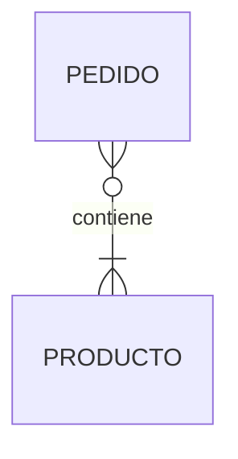

# Proceso de diseño

## En una frase

Diseñar una base de datos es pasar por tres niveles, cada uno con su pregunta: el **conceptual** (¿qué cosas existen en el negocio y cómo se relacionan?), el **lógico** (¿qué tablas, claves y relaciones las representan?) y el **físico** (¿con qué tipos, índices y opciones del motor se implementan?).

-----

## Antes de empezar

Conviene que ya sepas:

* Todo el módulo de [Fundamentos](../01-fundamentos/README.md): tablas, tipos, claves, restricciones y `NULL`.

Palabras nuevas (también están en el [Glosario](Glosario.md)):

* **Requisito:** algo que el sistema debe hacer o guardar, expresado por el negocio.
* **Regla de negocio:** una afirmación sobre el negocio que los datos deben respetar ("un pedido pertenece a un solo cliente").
* **Modelo conceptual:** descripción de las entidades del negocio y sus vínculos, independiente de cualquier tecnología.
* **Modelo lógico:** tablas, columnas, claves y relaciones, independiente del motor concreto.
* **Modelo físico:** la implementación en un motor concreto: tipos exactos, índices, esquemas, opciones de almacenamiento.
* **Patrón de acceso:** cómo se van a leer y escribir los datos (qué consultas, con qué frecuencia).

-----

## El problema

La forma más común de "diseñar" una base es abrir SSMS y escribir `CREATE TABLE` mientras se piensa. O peor: mirar la pantalla que hay que construir y crear una tabla con una columna por cada campo del formulario.

Funciona hasta que aparecen las preguntas que nadie hizo:

* "¿Un pedido puede tener productos de varios vendedores?" La tabla `Pedido` tiene una sola columna `VendedorId`.
* "Si el producto cambia de precio, ¿cambian los pedidos viejos?" El pedido no guarda el precio: lo lee del producto.
* "Necesitamos saber qué clientes compraron en las dos tiendas." Cada tienda tiene su propia tabla de clientes, con duplicados.

Cada una de estas preguntas, contestada **después** de tener datos en producción, significa una migración: alterar tablas, mover datos, cambiar consultas y código. Contestada **antes**, es una línea en un diagrama. El costo de cambiar un diseño crece con cada fila y con cada línea de código que depende de él.

-----

## Cómo funciona

### Los tres niveles

```text
  Negocio                     "Los clientes hacen pedidos de productos"
     │
     ▼
┌─────────────────────────┐
│ 1. Conceptual           │   Entidades: Cliente, Pedido, Producto
│    ¿QUÉ existe?         │   Vínculos:  Cliente realiza Pedido (1:N)
│    Sin tecnología       │   Diagrama entidad-relación
└───────────┬─────────────┘
            ▼
┌─────────────────────────┐
│ 2. Lógico               │   Tablas, columnas, PK, FK
│    ¿CÓMO se representa? │   Tablas intermedias para N:M
│    Sin motor concreto   │   Normalizado (3FN)
└───────────┬─────────────┘
            ▼
┌─────────────────────────┐
│ 3. Físico               │   NVARCHAR(100), DECIMAL(10,2), IDENTITY
│    ¿CON QUÉ se          │   Índices, esquemas, particiones
│    implementa?          │   Script de SQL Server
└─────────────────────────┘
```

| Nivel | Pregunta | Resultado | Quién lo entiende |
| --- | --- | --- | --- |
| **Conceptual** | ¿Qué cosas importan al negocio y cómo se relacionan? | Diagrama entidad-relación | El negocio y el equipo técnico |
| **Lógico** | ¿Qué tablas, claves y relaciones lo representan sin redundancia? | Esquema relacional normalizado | El equipo técnico |
| **Físico** | ¿Cómo se implementa de forma eficiente en este motor? | Script DDL con tipos, índices y opciones | El equipo técnico y el DBA |

Separar los niveles evita mezclar decisiones: no tiene sentido discutir si `Email` es `NVARCHAR(254)` (físico) cuando todavía no está claro si un cliente puede tener varios emails (conceptual).

### Paso 0: requisitos y reglas de negocio

Antes del primer diagrama, se escriben las reglas en lenguaje natural. Para la tienda:

1. Un **cliente** se registra con nombre y email; el email no se repite. La ciudad es opcional.
2. Un cliente puede hacer **muchos pedidos**; cada pedido es de **un solo** cliente.
3. Un pedido tiene **uno o más productos**, cada uno con una cantidad.
4. Un producto puede aparecer en **muchos pedidos**.
5. Cada producto pertenece a **una** categoría.
6. El precio de un producto puede cambiar, pero cada pedido **conserva el precio que se pagó**.
7. Un pedido pasa por los estados Pendiente, Pagado, Enviado, Entregado o Cancelado.
8. Los productos que ya no se venden no se borran: se desactivan.

Cada regla se traduce después en algo concreto: una entidad, un vínculo con su cardinalidad, una restricción o una columna. La regla 6, por ejemplo, es la que hace que `PrecioUnitario` viva en `DetallePedido` y no solo en `Producto`.

Las reglas salen de **preguntar**. Las preguntas que más diseño ahorran son de este tipo:

* "¿Puede haber un X sin un Y?" (¿Un pedido sin productos? ¿Un producto sin categoría?)
* "¿Puede un X tener más de un Y?" (¿Un cliente con varias direcciones?)
* "¿Qué pasa con X cuando Y cambia o desaparece?" (¿Qué pasa con los pedidos si se borra un producto?)
* "¿Hay que saber cómo era esto antes?" (¿Importa el historial de precios?)

### Paso 1: modelo conceptual

Se identifican las **entidades** (sustantivos importantes: Cliente, Pedido, Producto, Categoría), sus **atributos** y los **vínculos** entre ellas, con su cardinalidad. Se dibuja como un diagrama entidad-relación, sin tipos de datos ni tablas intermedias. Se explica en [Modelo entidad-relación](02-Modelo%20entidad-relación.md) y en [Cardinalidad y relaciones](03-Cardinalidad%20y%20relaciones.md).

### Paso 2: modelo lógico

El diagrama se traduce a tablas siguiendo reglas fijas: cada entidad es una tabla, cada vínculo 1:N es una clave foránea, cada vínculo N:M es una tabla intermedia ([Del modelo ER a tablas](04-Del%20modelo%20ER%20a%20tablas.md)). Después se verifica que no haya redundancia con la **normalización** ([Dependencias funcionales](05-Dependencias%20funcionales.md) y [Normalización](06-Normalización%201FN%202FN%203FN.md)).

### Paso 3: modelo físico

Con el modelo lógico estable, se toman las decisiones del motor:

* Tipos exactos y longitudes ([Tipos de datos](../01-fundamentos/03-Tipos%20de%20datos.md)).
* Estrategia de claves: `IDENTITY`, GUID ([Claves primarias](../01-fundamentos/04-Claves%20primarias.md)).
* Índices para las consultas frecuentes y para las claves foráneas.
* Esquemas, nombres y convenciones ([Convenciones de nombres](10-Convenciones%20de%20nombres.md)).
* Desnormalizaciones justificadas por rendimiento, si las hay ([Desnormalización](08-Desnormalización.md)).

### Es un proceso iterativo

Los niveles no se hacen una sola vez y en orden estricto. Al pasar al lógico aparecen preguntas que obligan a volver al conceptual ("al normalizar descubrimos que la dirección de envío es distinta de la del cliente: ¿es otra entidad?"). Lo importante es que cada vuelta sea **antes** de que haya datos en producción, cuando cambiar cuesta poco.

-----

## Ejemplo completo

El diseño de la tienda, recorriendo los tres niveles para un fragmento: la regla 6 ("el pedido conserva el precio pagado").

**Conceptual:** Pedido y Producto tienen un vínculo N:M ("un pedido contiene productos"). El vínculo tiene sus propios atributos: la cantidad y el precio pagado.



**Lógico:** el N:M se convierte en una tabla intermedia con los atributos del vínculo:

```text
Pedido(PedidoId PK, ClienteId FK, FechaPedido, Estado)
Producto(ProductoId PK, CategoriaId FK, Nombre, Precio, Stock, Activo)
DetallePedido(PedidoId PK FK, ProductoId PK FK, Cantidad, PrecioUnitario)
```

`Producto.Precio` es el precio **actual**; `DetallePedido.PrecioUnitario` es el precio **pagado**. Son dos hechos distintos, aunque hoy coincidan.

**Físico** (SQL Server):

```sql
CREATE TABLE dbo.DetallePedido (
    PedidoId       INT           NOT NULL,
    ProductoId     INT           NOT NULL,
    Cantidad       INT           NOT NULL,
    PrecioUnitario DECIMAL(10,2) NOT NULL,
    CONSTRAINT PK_DetallePedido PRIMARY KEY (PedidoId, ProductoId),
    CONSTRAINT FK_DetallePedido_Pedido FOREIGN KEY (PedidoId)
        REFERENCES dbo.Pedido (PedidoId) ON DELETE CASCADE,
    CONSTRAINT FK_DetallePedido_Producto FOREIGN KEY (ProductoId)
        REFERENCES dbo.Producto (ProductoId),
    CONSTRAINT CK_DetallePedido_Cantidad CHECK (Cantidad > 0)
);

CREATE INDEX IX_DetallePedido_ProductoId ON dbo.DetallePedido (ProductoId);
```

Resultado con los datos: el pedido 2 se pagó a 849.90 aunque hoy el monitor cuesta 899.90.

| PedidoId | Producto | Precio pagado | Precio actual |
| --- | --- | --- | --- |
| 2 | Monitor 27 pulgadas | 849.90 | 899.90 |

Una regla de negocio en lenguaje natural terminó siendo una columna, una clave compuesta, dos claves foráneas, un `CHECK` y un índice. Eso es el proceso de diseño. El esquema completo está en el [esquema de ejemplo](../00-Esquema%20de%20ejemplo.md).

-----

## Errores comunes

**1. Empezar por el `CREATE TABLE`.**
Qué pasa: decisiones físicas (tipos, índices) tomadas antes de entender el negocio, y migraciones constantes después.
Por qué: escribir SQL parece avanzar más rápido que dibujar.
Arreglo: reglas de negocio → diagrama → tablas → script, aunque sea en una hoja.

**2. Diseñar a partir de las pantallas.**
Qué pasa: una tabla por formulario, con columnas `Producto1`, `Producto2`, `Producto3` porque la pantalla tiene tres filas.
Por qué: la pantalla muestra una **vista** de los datos, no su estructura.
Arreglo: diseña a partir de las entidades y las reglas; las pantallas se construyen con consultas sobre ese diseño.

**3. Diseñar a partir de las clases del ORM sin pensar en las tablas.**
Qué pasa: EF Core genera tablas con tipos por defecto (`nvarchar(max)` para cada `string`), sin índices ni restricciones de negocio.
Por qué: se delega el modelo físico a una herramienta que no conoce las reglas.
Arreglo: el ORM es una herramienta para implementar el diseño, no para hacerlo. Configura tipos, longitudes, índices y restricciones de forma explícita.

**4. No preguntar por el historial.**
Qué pasa: un cambio de precio, de dirección o de estado reescribe el pasado, y los reportes históricos cambian solos.
Por qué: se modela solo el estado actual.
Arreglo: pregunta siempre "¿hay que saber cómo era antes?". Si la respuesta es sí, el dato se copia al momento del hecho (como `PrecioUnitario`) o se guarda un historial.

**5. Diseñar para todos los casos imaginables.**
Qué pasa: tablas genéricas como `Entidad`, `Atributo`, `Valor` "por si el negocio cambia", imposibles de consultar y de validar.
Por qué: miedo a tener que cambiar el diseño.
Arreglo: diseña para las reglas que existen; un buen diseño normalizado es fácil de extender (ver el antipatrón EAV en [Patrones de modelado](09-Patrones%20de%20modelado.md)).

-----

## Según el motor

Los niveles conceptual y lógico son **iguales** para SQL Server, PostgreSQL y MySQL: un buen modelo lógico se puede implementar en cualquiera de los tres. Las diferencias aparecen en el físico:

| Decisión física | SQL Server | PostgreSQL | MySQL |
| --- | --- | --- | --- |
| Autoincremento | `IDENTITY` | `GENERATED ... AS IDENTITY` | `AUTO_INCREMENT` |
| Texto | `NVARCHAR(n)` | `text` / `varchar(n)` | `VARCHAR(n)` con `utf8mb4` |
| Organización física | Índice agrupado elegible | *Heap* + índices | La tabla es el índice de la PK |
| Agrupación de objetos | Esquemas (`ventas.Pedido`) | Esquemas | Bases de datos separadas |
| Convención de nombres habitual | `PascalCase` | `snake_case` | `snake_case` |

### En MongoDB

El proceso cambia de orden. En relacional, se diseña a partir de las **entidades** y después se escriben las consultas que se necesiten, porque un modelo normalizado responde bien a casi cualquier consulta. En MongoDB se diseña a partir de los **patrones de acceso**: primero se listan las consultas más frecuentes ("mostrar un pedido con sus productos", "listar los pedidos de un cliente") y se modelan los documentos para que cada consulta lea un solo documento. El mismo negocio puede producir diseños documentales muy distintos según cómo se lean los datos.

-----

## Cuándo sí y cuándo no

**Haz el proceso completo cuando:**

* El sistema va a durar y a crecer: casi siempre.
* Hay reglas de negocio no triviales (dinero, historial, estados).

**Puedes abreviar cuando:**

* Es un prototipo para validar una idea, sabiendo que el diseño se va a rehacer.
* Es una tabla auxiliar aislada (una tabla de configuración, una de *staging*).

Aun así, el paso 0 (escribir las reglas) nunca sobra: son diez minutos que ahorran migraciones.

**Herramientas que ayudan:**

* **Diagramas:** draw.io (diagrams.net), dbdiagram.io (diagramas desde texto con DBML), Mermaid (diagramas en Markdown, como los de este wiki).
* **Modelado con generación de DDL:** MySQL Workbench, pgModeler, ER/Studio, DbSchema.
* **A partir de una base existente:** los diagramas de SSMS o de DBeaver dibujan el modelo desde las claves foráneas.

-----

## Resumen en 5 líneas

1. Diseñar es pasar por tres niveles: conceptual (qué existe), lógico (qué tablas y claves) y físico (qué tipos e índices en este motor).
2. Todo empieza por las reglas de negocio escritas en lenguaje natural, y salen de preguntar.
3. Cada regla termina en algo concreto: una entidad, un vínculo, una restricción o una columna.
4. Cambiar el diseño es barato antes de tener datos y caro después: el proceso adelanta las preguntas.
5. No se diseña desde las pantallas ni desde el ORM, y siempre se pregunta por el historial.

-----

## Para profundizar

<details>
<summary>La arquitectura ANSI/SPARC de tres niveles</summary>

En 1975, el comité ANSI/SPARC propuso separar tres niveles de descripción de una base: el **externo** (lo que ve cada usuario o aplicación, como las vistas), el **conceptual** (la estructura lógica completa) y el **interno** (el almacenamiento físico). La independencia lógica de datos es poder cambiar el nivel conceptual sin afectar al externo; la física, cambiar el interno sin afectar al conceptual. Los niveles conceptual, lógico y físico del diseño son la versión práctica de esa misma idea.

</details>

<details>
<summary>Lecturas recomendadas</summary>

* *Database Design for Mere Mortals*, Michael J. Hernandez: el proceso completo, desde las entrevistas con el negocio, sin matemáticas.
* *Fundamentos de sistemas de bases de datos*, Elmasri y Navathe: los capítulos de modelado ER y de diseño lógico.
* *SQL Antipatterns*, Bill Karwin: errores de diseño frecuentes y cómo evitarlos.

</details>

-----

## En entrevista

### Respuesta corta (junior)

Primero entiendo el negocio y escribo las reglas: qué entidades hay y cómo se relacionan. Después hago un diagrama entidad-relación, lo paso a tablas con claves primarias y foráneas, lo normalizo, y al final elijo los tipos de datos y los índices para el motor que vamos a usar.

### Respuesta ampliada (semi-senior)

Trabajo en tres niveles. En el conceptual levanto las reglas de negocio con preguntas concretas (¿puede existir X sin Y?, ¿X puede tener varios Y?, ¿hay que guardar el historial?) y las represento en un diagrama entidad-relación con sus cardinalidades. En el lógico traduzco ese diagrama a tablas con reglas fijas (entidades a tablas, 1:N a claves foráneas, N:M a tablas intermedias) y lo valido con normalización hasta 3FN o BCNF. En el físico decido tipos, estrategia de claves, índices para las consultas frecuentes y las claves foráneas, esquemas y nombres, y solo ahí desnormalizo, si hay una necesidad de rendimiento medida. Es iterativo, pero intento cerrar las preguntas de negocio antes de tener datos en producción, porque ahí cada cambio se vuelve una migración. No diseño a partir de las pantallas ni dejo que el ORM decida el modelo físico.

### Preguntas frecuentes de seguimiento

**1. ¿Qué diferencia hay entre el modelo lógico y el físico?**
El lógico define tablas, columnas, claves y relaciones sin depender de un motor; el físico agrega las decisiones de implementación: tipos exactos, índices, particiones, opciones de almacenamiento.

**2. ¿Por qué no diseñar a partir de las pantallas?**
Porque una pantalla es una vista de los datos para un caso de uso. Si el diseño la copia, aparecen columnas repetidas, datos duplicados y un modelo que no sirve para la siguiente pantalla.

**3. ¿Cómo descubres las reglas de negocio?**
Con preguntas de cardinalidad y de ciclo de vida: si algo puede existir sin otra cosa, si puede tener varias, qué pasa cuando cambia o desaparece, y si hay que conservar cómo era antes.

**4. ¿El diseño en MongoDB sigue el mismo proceso?**
No del todo: en documental se parte de los patrones de acceso, y los documentos se modelan para que las consultas frecuentes lean un solo documento.

-----

## Práctica

**Ejercicio 1.** Una biblioteca te dice: "Prestamos libros a los socios. Tenemos varios ejemplares de algunos libros. Un socio puede tener hasta 3 préstamos a la vez. Queremos saber quién tuvo cada ejemplar y cuándo lo devolvió". Escribe las reglas de negocio numeradas y las preguntas que le harías a la biblioteca antes de diseñar.

<details>
<summary>Solución</summary>

Reglas:

1. Un **libro** (título, autor, ISBN) puede tener **uno o más ejemplares**.
2. Un **ejemplar** es una copia física de un solo libro.
3. Un **socio** puede tener muchos **préstamos** a lo largo del tiempo, y como máximo 3 activos a la vez.
4. Un préstamo es de **un** ejemplar a **un** socio, con fecha de préstamo y fecha de devolución (vacía mientras no se devuelve).
5. Hay que conservar el **historial**: quién tuvo cada ejemplar y cuándo.

Preguntas para la biblioteca:

* ¿Un libro puede tener varios autores? (Cambia el vínculo de 1:N a N:M.)
* ¿Hay fecha límite de devolución? ¿Se cobran multas?
* ¿Un ejemplar puede darse de baja (perdido, dañado)? ¿Se borra o se marca?
* ¿Los socios pueden reservar un libro que está prestado?
* ¿El límite de 3 préstamos es igual para todos los socios?

Detalle importante: "como máximo 3 activos" es una regla entre filas, que no se puede expresar con un `CHECK`. Se anota desde ahora para resolverla en la aplicación o con una transacción.

</details>

**Ejercicio 2.** Clasifica cada decisión como conceptual, lógica o física:

1. "Un pedido puede tener varias direcciones de envío."
2. "`Email` será `NVARCHAR(254)`."
3. "La relación entre Pedido y Producto necesita una tabla intermedia."
4. "Crear un índice sobre `Pedido.FechaPedido` para el reporte mensual."
5. "Un producto pertenece a una sola categoría."
6. "La tabla `Cliente` va en el esquema `ventas`."

<details>
<summary>Solución</summary>

1. **Conceptual:** es una regla de cardinalidad del negocio.
2. **Físico:** tipo y longitud concretos del motor.
3. **Lógico:** cómo se representa un N:M en el modelo relacional.
4. **Físico:** optimización para un patrón de acceso.
5. **Conceptual:** regla de negocio.
6. **Físico:** organización de objetos en el motor.

</details>

-----

## Siguiente lección

[Modelo entidad-relación](02-Modelo%20entidad-relación.md)
