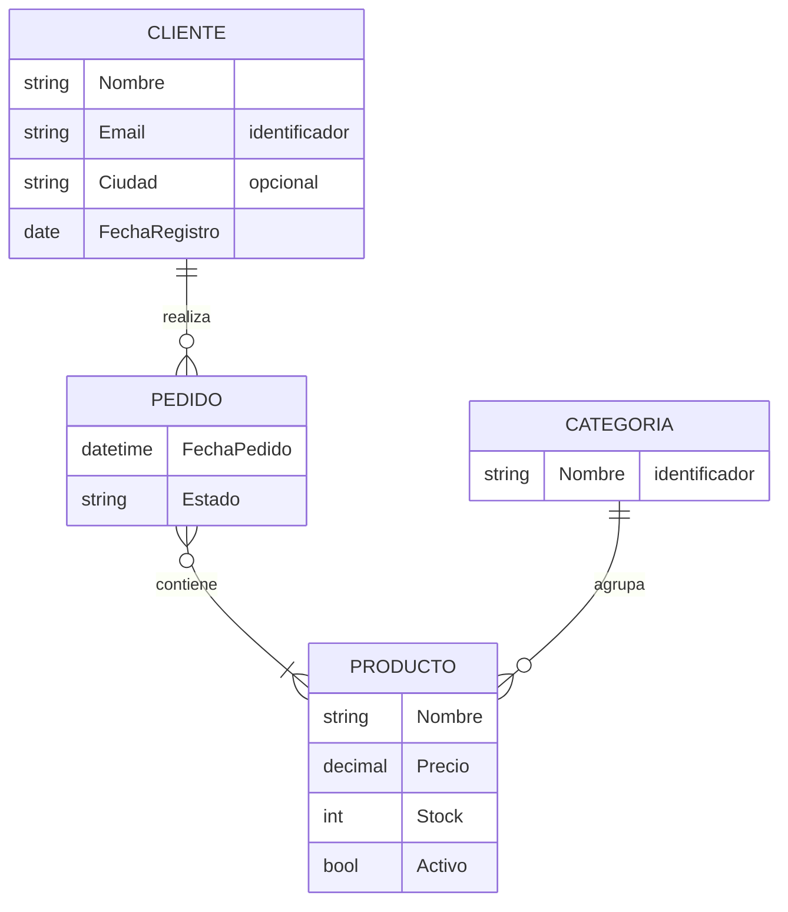
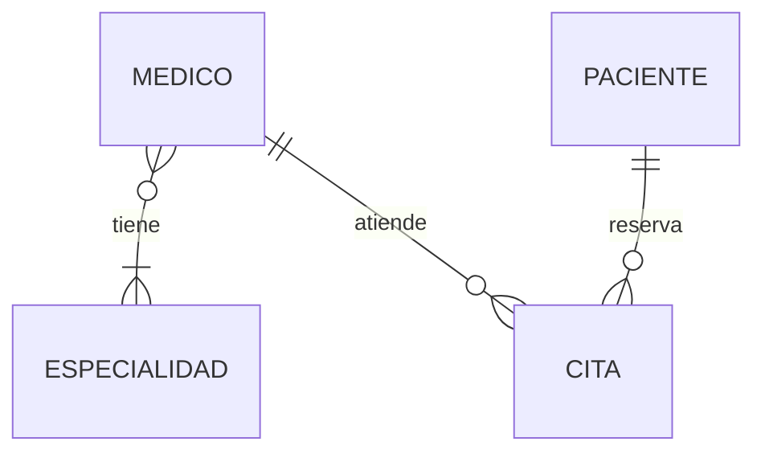

# Modelo entidad-relación

## En una frase

El modelo entidad-relación (ER) describe el negocio con tres piezas, **entidades** (las cosas que importan), **atributos** (lo que se sabe de ellas) y **relaciones** (cómo se vinculan), y lo dibuja en un diagrama que entienden por igual el negocio y el equipo técnico.

-----

## Antes de empezar

Conviene que ya sepas:

* Los tres niveles de diseño y las reglas de negocio de la tienda, de [Proceso de diseño](01-Proceso%20de%20diseño.md).
* Claves primarias y candidatas, de [Claves primarias](../01-fundamentos/04-Claves%20primarias.md).

Palabras nuevas (también están en el [Glosario](Glosario.md)):

* **Entidad:** algo del negocio de lo que se quiere guardar información (Cliente, Pedido).
* **Instancia (ocurrencia):** un ejemplar concreto de una entidad (la clienta Ana Torres).
* **Atributo:** una propiedad de la entidad (nombre, email).
* **Identificador:** el atributo o conjunto de atributos que distingue cada instancia; en el modelo lógico se convierte en la clave primaria.
* **Relación (vínculo):** asociación entre entidades ("un cliente **realiza** pedidos"). Aquí sí significa vínculo; no confundir con la relación del modelo relacional.
* **Entidad débil:** entidad que no se puede identificar sin otra entidad de la que depende.
* **Notación pata de gallo (crow's foot):** forma de dibujar las cardinalidades con símbolos en los extremos de cada línea.

-----

## El problema

Las reglas de negocio en lenguaje natural son el punto de partida, pero tienen dos defectos:

* **Son ambiguas.** "Los clientes compran productos" no dice si se guarda cada compra, si un cliente puede comprar el mismo producto dos veces ni qué datos tiene una compra.
* **No se ven en conjunto.** Con veinte reglas escritas, es difícil notar que dos se contradicen o que falta una entidad.

Saltar directamente a las tablas tampoco sirve: obliga a decidir claves foráneas y tablas intermedias antes de entender qué se está modelando, y el negocio no puede revisar un script SQL.

Hace falta un lenguaje intermedio: más preciso que el texto, menos técnico que el SQL, y visual. Eso es el modelo ER, propuesto por Peter Chen en 1976.

-----

## Cómo funciona

### Entidades: los sustantivos importantes

Una técnica simple para encontrar entidades es subrayar los **sustantivos** de las reglas de negocio y quedarse con los que cumplen tres condiciones:

1. El negocio necesita **guardar información** sobre ellos.
2. Tienen **varias instancias** (hay muchos clientes, muchos pedidos).
3. Cada instancia se puede **distinguir** de las demás.

En las reglas de la tienda: **cliente**, **pedido**, **producto**, **categoría**. En cambio, "email" es un sustantivo, pero es un **atributo** del cliente, no una entidad. "Tienda" es un sustantivo, pero hay una sola: no es una entidad (salvo que el negocio tenga varias sucursales).

### Atributos y sus tipos

| Tipo de atributo | Qué es | Ejemplo | Cómo se resuelve después |
| --- | --- | --- | --- |
| **Simple** | Un valor indivisible | `Nombre`, `Precio` | Una columna |
| **Compuesto** | Se divide en partes con significado | `Dirección` = calle + número + ciudad | Una columna por parte |
| **Multivaluado** | Puede tener varios valores para una instancia | `Teléfonos` de un cliente | Una tabla aparte |
| **Derivado** | Se calcula a partir de otros | `Total` del pedido = suma de los detalles | Normalmente no se guarda: se calcula |
| **Identificador** | Distingue cada instancia | `Email` del cliente | La clave primaria o una alternativa |
| **Opcional** | Puede no tener valor | `Ciudad` | Una columna `NULL` |

Detectar los atributos multivaluados y derivados en esta etapa evita dos errores clásicos: una columna `Telefonos` con una lista separada por comas y una columna `Total` que deja de coincidir con la suma de los detalles. Cómo se traduce cada tipo a tablas se ve en [Del modelo ER a tablas](04-Del%20modelo%20ER%20a%20tablas.md).

### Relaciones: los verbos

Las relaciones salen de los **verbos** que conectan entidades: un cliente **realiza** pedidos, un pedido **contiene** productos, una categoría **agrupa** productos. Cada relación tiene:

* **Un nombre** (un verbo), que permite leerla como una frase.
* **Una cardinalidad** en cada extremo: cuántas instancias de una entidad pueden asociarse con una instancia de la otra (uno o muchos) y si es obligatorio (cero o al menos uno). Se estudia a fondo en [Cardinalidad y relaciones](03-Cardinalidad%20y%20relaciones.md).
* **Atributos propios**, a veces. La cantidad de un producto en un pedido no es del pedido ni del producto: es **de la relación** "contiene".

### Entidades débiles

Una entidad es **débil** cuando no puede identificarse sola: necesita el identificador de otra entidad (su **propietaria**).

Ejemplo: un edificio tiene aulas numeradas. El aula "101" existe en el edificio A y en el edificio B. "101" no identifica un aula; "edificio A, aula 101" sí.

```text
Edificio (fuerte)      Aula (débil)
EdificioId: A          (A, 101)
                       (A, 102)
EdificioId: B          (B, 101)
```

En el modelo lógico, la clave primaria de una entidad débil incluye la clave de su propietaria: `PRIMARY KEY (EdificioId, NumeroAula)`. Y si se borra el edificio, sus aulas dejan de tener sentido (una candidata natural para `ON DELETE CASCADE`).

### Notaciones

Hay varias formas de dibujar el mismo modelo. Las dos que más vas a ver:

**Chen** (la original, común en la universidad): rectángulos para las entidades, rombos para las relaciones y óvalos para los atributos.

```text
 ┌─────────┐       ╱──────────╲       ┌────────┐
 │ CLIENTE │──1───<  realiza   >───N──│ PEDIDO │
 └─────────┘       ╲──────────╱       └────────┘
      │                                    │
   (Email)                           (FechaPedido)
```

**Pata de gallo** (*crow's foot*, o notación de Martin/IE; la más usada en la industria y en las herramientas): rectángulos con los atributos dentro y símbolos en los extremos de las líneas.

| Entidad a la izquierda | Entidad a la derecha | Lectura |
| --- | --- | --- |
| `\|\|` | `\|\|` | Exactamente uno |
| `\|o` | `o\|` | Cero o uno |
| `}\|` | `\|{` | Uno o muchos |
| `}o` | `o{` | Cero o muchos |

El símbolo más cercano a la entidad indica el **máximo** (`|` = uno, `}` o `{` = muchos, la "pata de gallo"); el más lejano, el **mínimo** (`o` = cero, `|` = uno).

Este wiki usa la pata de gallo con [Mermaid](https://mermaid.js.org/syntax/entityRelationshipDiagram.html), que GitHub dibuja directamente desde el Markdown:

```text
CLIENTE ||--o{ PEDIDO : realiza
```

Se lee en las dos direcciones: "un cliente realiza **cero o muchos** pedidos" y "un pedido es realizado por **exactamente un** cliente".

-----

## Ejemplo completo

Construir el modelo ER de la tienda a partir de las reglas de [Proceso de diseño](01-Proceso%20de%20diseño.md):

**1. Entidades** (sustantivos con varias instancias distinguibles): Cliente, Pedido, Producto, Categoría.

**2. Atributos:**

| Entidad | Atributos | Observaciones |
| --- | --- | --- |
| Cliente | Nombre, **Email**, Ciudad, FechaRegistro | Email identifica; Ciudad es opcional |
| Pedido | FechaPedido, Estado, *Total* | *Total* es derivado: no se guarda |
| Producto | Nombre, Precio, Stock, Activo | Precio es el precio actual |
| Categoría | **Nombre** | El nombre identifica |

**3. Relaciones** (verbos, con su cardinalidad y sus atributos):

| Relación | Entre | Cardinalidad | Atributos propios |
| --- | --- | --- | --- |
| realiza | Cliente – Pedido | 1 : N | — |
| contiene | Pedido – Producto | N : M | Cantidad, PrecioUnitario |
| agrupa | Categoría – Producto | 1 : N | — |

**4. Diagrama conceptual:**



Cómo se lee cada línea:

* Un cliente realiza **cero o muchos** pedidos (Sofía no tiene ninguno); un pedido es de **un** cliente.
* Un pedido contiene **uno o muchos** productos; un producto aparece en **cero o muchos** pedidos.
* Una categoría agrupa **cero o muchos** productos; un producto pertenece a **una** categoría.

Fíjate en lo que el diagrama conceptual **todavía no tiene**: no hay `ClienteId`, no hay claves foráneas, no hay tabla `DetallePedido` y no hay tipos de SQL Server. Todo eso es del nivel lógico y del físico. La cantidad y el precio pagado son atributos de la relación "contiene"; en [Del modelo ER a tablas](04-Del%20modelo%20ER%20a%20tablas.md) se convierten en la tabla `DetallePedido`.

-----

## Errores comunes

**1. Convertir cada sustantivo en una entidad.**
Qué pasa: entidades como `Email`, `Precio` o `Tienda` (con una sola instancia).
Por qué: no se aplica el filtro de "varias instancias distinguibles sobre las que se guarda información".
Arreglo: si es una propiedad de otra cosa, es un atributo. Si hay una sola instancia, probablemente es configuración.

**2. Poner claves foráneas en el diagrama conceptual.**
Qué pasa: el diagrama "conceptual" es en realidad el script SQL dibujado, y el negocio no puede revisarlo.
Por qué: se mezclan los niveles.
Arreglo: en el conceptual, las relaciones son líneas con verbos; las FK aparecen en el lógico.

**3. Olvidar los atributos de la relación.**
Qué pasa: la cantidad termina en `Pedido` (¿cantidad de qué producto?) o en `Producto` (¿en qué pedido?).
Por qué: se piensa que todo atributo tiene que pertenecer a una entidad.
Arreglo: pregunta "¿de qué depende este dato?". Si depende de la combinación de dos entidades, es de la relación.

**4. Guardar atributos derivados sin pensarlo.**
Qué pasa: `Pedido.Total` que dice 211.00 mientras la suma de sus detalles dice 256.50, porque alguien agregó un detalle y no actualizó el total.
Por qué: guardar un valor calculado crea dos fuentes de verdad.
Arreglo: calcula los derivados. Si hace falta guardarlos por rendimiento, es una decisión física y consciente (ver [Desnormalización](08-Desnormalización.md)).

**5. Leer la cardinalidad en una sola dirección.**
Qué pasa: "un cliente tiene muchos pedidos" se modela, pero nadie preguntó si un pedido puede ser de varios clientes (compras compartidas).
Por qué: se lee la relación solo desde un lado.
Arreglo: toda relación se lee en las dos direcciones, y cada lectura es una pregunta para el negocio.

-----

## Según el motor

El modelo ER es **conceptual**: no depende de ningún motor. Es el mismo diagrama para SQL Server, PostgreSQL o MySQL. Lo que cambia son las herramientas que lo dibujan o lo generan:

| Herramienta | Motor | Qué ofrece |
| --- | --- | --- |
| Diagramas de SSMS | SQL Server | Dibuja el modelo desde una base existente (nivel físico) |
| MySQL Workbench | MySQL | Modelado visual con generación de DDL e ingeniería inversa |
| pgModeler / pgAdmin ERD | PostgreSQL | Modelado y generación de DDL |
| dbdiagram.io, DBeaver, draw.io | Multimotor | Diagramas desde texto (DBML) o desde la base |

### En MongoDB

Las entidades y las relaciones siguen existiendo en el negocio, y el diagrama ER sigue siendo útil para entenderlo. Lo que cambia es la traducción: en lugar de convertir cada entidad en una colección, se decide para cada relación si se **embebe** (los detalles dentro del documento del pedido) o se **referencia** (el pedido guarda el `_id` del cliente). La regla general: se embebe lo que se lee junto y pertenece al padre; se referencia lo que tiene vida propia o crece sin límite.

-----

## Cuándo sí y cuándo no

**Haz un diagrama ER cuando:**

* El modelo tiene más de tres o cuatro entidades: el diagrama muestra lo que el texto esconde.
* Necesitas validar el diseño con el negocio: un diagrama con verbos se puede leer en voz alta en una reunión.
* Documentas una base existente para el equipo.

**Ten en cuenta:**

* El diagrama no reemplaza a las reglas escritas: hay reglas (como "máximo 3 préstamos activos") que no se pueden dibujar.
* Un diagrama desactualizado es peor que ninguno. Si el modelo vive en el repositorio (como texto Mermaid o DBML), se actualiza en el mismo commit que la migración.

**Herramientas que ayudan:**

* **Mermaid:** diagramas como texto dentro del Markdown, versionados con git.
* **dbdiagram.io:** diagramas a partir de DBML, con exportación a SQL.
* **draw.io:** diagramas libres, con plantillas de pata de gallo.

-----

## Resumen en 5 líneas

1. Entidades = sustantivos con varias instancias distinguibles; atributos = lo que se sabe de ellas; relaciones = verbos que las conectan.
2. Los atributos pueden ser simples, compuestos, multivaluados, derivados, identificadores u opcionales, y cada tipo se traduce distinto.
3. Las relaciones pueden tener atributos propios (la cantidad pertenece a "pedido contiene producto").
4. Una entidad débil se identifica con ayuda de su propietaria (aula 101 del edificio A).
5. La notación pata de gallo indica máximo y mínimo en cada extremo; toda relación se lee en las dos direcciones.

-----

## Para profundizar

<details>
<summary>Generalización y especialización (modelo ER extendido)</summary>

El modelo ER extendido (EER) agrega la **herencia**: una entidad general (Persona) con subtipos (Cliente, Empleado) que heredan sus atributos y agregan los propios. Se define si la especialización es:

* **Total o parcial:** ¿toda persona es cliente o empleado, o puede ser otra cosa?
* **Disjunta o solapada:** ¿una persona puede ser cliente **y** empleado a la vez?

Esas dos preguntas deciden cómo se implementa en tablas (una tabla para todos, una por subtipo o una por cada clase). Se estudia en [Patrones de modelado](09-Patrones%20de%20modelado.md).

</details>

<details>
<summary>Relaciones ternarias</summary>

Algunas relaciones conectan **tres** entidades a la vez: "un profesor dicta una materia en un aula". No siempre se puede descomponer en tres relaciones binarias sin perder información: saber qué profesor dicta qué materia, qué materia se da en qué aula y qué profesor usa qué aula no siempre permite reconstruir qué profesor dicta qué materia en qué aula. En tablas, una relación ternaria se convierte en una tabla con tres claves foráneas.

</details>

-----

## En entrevista

### Respuesta corta (junior)

El modelo entidad-relación representa el negocio con entidades (como Cliente o Pedido), sus atributos y las relaciones entre ellas, con su cardinalidad (uno a uno, uno a muchos, muchos a muchos). Se dibuja en un diagrama antes de crear las tablas, normalmente con la notación pata de gallo.

### Respuesta ampliada (semi-senior)

Uso el modelo ER en el nivel conceptual, para validar el negocio antes de pensar en tablas. Las entidades salen de los sustantivos que tienen varias instancias distinguibles; las relaciones, de los verbos, con su cardinalidad máxima y mínima en cada extremo, que leo en las dos direcciones como preguntas para el negocio. Clasifico los atributos porque cada tipo se traduce distinto: los compuestos se dividen en columnas, los multivaluados van a una tabla aparte y los derivados normalmente no se guardan. También identifico los atributos de las relaciones (la cantidad en "pedido contiene producto") y las entidades débiles, cuya clave incluye la de su propietaria. Dibujo con pata de gallo y mantengo el diagrama como texto (Mermaid o DBML) en el repositorio, para que se actualice junto con las migraciones.

### Preguntas frecuentes de seguimiento

**1. ¿Qué es una entidad débil?**
Una que no se identifica sola: su clave incluye la de la entidad de la que depende, como un aula identificada por edificio y número.

**2. ¿Qué es un atributo multivaluado y cómo se implementa?**
Un atributo que puede tener varios valores para la misma instancia, como los teléfonos de un cliente. Se implementa como una tabla aparte, con una fila por valor.

**3. ¿Por qué no guardar los atributos derivados?**
Porque crean dos fuentes de verdad que pueden dejar de coincidir. Se calculan; guardarlos es una decisión física por rendimiento.

**4. ¿Cómo se lee `||--o{`?**
De izquierda a derecha: "uno (y solo uno) se relaciona con cero o muchos". Por ejemplo, un cliente realiza cero o muchos pedidos, y cada pedido es de exactamente un cliente.

-----

## Práctica

**Ejercicio 1.** A partir de estas reglas, identifica entidades, atributos (con su tipo) y relaciones (con su cardinalidad y sus atributos propios):

> "Una clínica tiene médicos, cada uno con una o más especialidades. Los pacientes se registran con su DNI, nombre, fecha de nacimiento y uno o varios teléfonos. Un paciente reserva citas con un médico en una fecha y hora; en cada cita, el médico anota un diagnóstico. Queremos mostrar la edad del paciente."

<details>
<summary>Solución</summary>

**Entidades:** Médico, Especialidad, Paciente, Cita.

**Atributos:**

| Entidad | Atributo | Tipo |
| --- | --- | --- |
| Paciente | DNI | Identificador |
| Paciente | Nombre, FechaNacimiento | Simples |
| Paciente | Teléfonos | Multivaluado → tabla aparte |
| Paciente | Edad | Derivado de FechaNacimiento → no se guarda |
| Cita | FechaHora, Diagnóstico | Simples (el diagnóstico es opcional hasta que ocurre la cita) |

**Relaciones:**

| Relación | Entre | Cardinalidad |
| --- | --- | --- |
| tiene | Médico – Especialidad | N : M (un médico, una o más especialidades; una especialidad, muchos médicos) |
| reserva | Paciente – Cita | 1 : N |
| atiende | Médico – Cita | 1 : N |

**Cita** podría verse como una relación N:M entre Paciente y Médico con atributos (fecha, diagnóstico), pero conviene modelarla como entidad: tiene identidad propia, el mismo paciente puede tener varias citas con el mismo médico y otras cosas pueden relacionarse con ella (recetas, pagos).



</details>

**Ejercicio 2.** ¿Entidad, atributo o relación? Justifica: (a) el **color** de un producto, si cada producto tiene uno solo; (b) el color, si un producto se vende en varios colores con stock distinto por color; (c) la **dirección de envío** de un pedido.

<details>
<summary>Solución</summary>

* **a) Atributo** simple del producto.
* **b) Entidad o relación con atributos:** el stock depende de la combinación producto-color. Hace falta algo como `VarianteProducto(Producto, Color, Stock)`. El color puede ser también una entidad (catálogo de colores).
* **c) Depende de la regla.** Si el pedido guarda la dirección como estaba al momento de la compra, es un atributo compuesto del pedido (calle, número, ciudad), copiado aunque el cliente cambie de dirección después. Si los clientes guardan una libreta de direcciones y eligen una, hay una entidad `Dirección` relacionada con Cliente (1:N), y el pedido igual debería conservar una copia por el historial.

</details>

-----

## Siguiente lección

[Cardinalidad y relaciones](03-Cardinalidad%20y%20relaciones.md)
