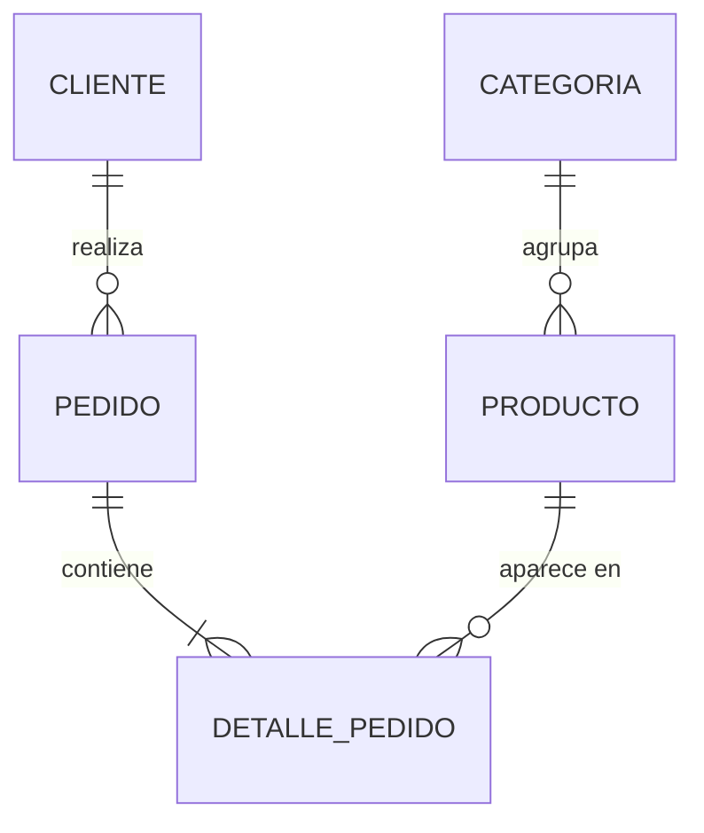

# Cardinalidad y relaciones

## En una frase

La cardinalidad de una relación dice **cuántas** instancias de una entidad pueden vincularse con una instancia de la otra (uno o muchos: 1:1, 1:N, N:M) y **si el vínculo es obligatorio** (cero o al menos uno); de esas dos respuestas depende dónde va la clave foránea y si hace falta una tabla intermedia.

-----

## Antes de empezar

Conviene que ya sepas:

* Entidades, relaciones y la notación pata de gallo, de [Modelo entidad-relación](02-Modelo%20entidad-relación.md).
* Claves foráneas, FK opcionales y autorreferencia, de [Claves foráneas](../01-fundamentos/05-Claves%20foráneas%20e%20integridad%20referencial.md).

Palabras nuevas (también están en el [Glosario](Glosario.md)):

* **Cardinalidad máxima:** el máximo de instancias con las que se puede vincular una instancia: uno o muchos.
* **Cardinalidad mínima (participación):** el mínimo: cero (participación opcional) o uno (obligatoria).
* **1:1, 1:N, N:M:** uno a uno, uno a muchos, muchos a muchos.
* **Tabla intermedia (asociativa, de unión):** tabla que implementa una relación N:M con dos claves foráneas.
* **Relación recursiva (reflexiva):** relación de una entidad consigo misma.

-----

## El problema

Mira estos tres diseños para "un pedido contiene productos":

```sql
-- A: la FK en Pedido
CREATE TABLE dbo.Pedido (PedidoId INT PRIMARY KEY, ProductoId INT REFERENCES dbo.Producto);

-- B: la FK en Producto
CREATE TABLE dbo.Producto (ProductoId INT PRIMARY KEY, PedidoId INT REFERENCES dbo.Pedido);

-- C: una lista en Pedido
CREATE TABLE dbo.Pedido (PedidoId INT PRIMARY KEY, Productos VARCHAR(500));   -- '1,2,6'
```

* **A** solo permite **un** producto por pedido.
* **B** solo permite que cada producto esté en **un** pedido: una vez vendido el teclado, nadie más puede comprarlo.
* **C** permite muchos, pero no hay integridad (`'1,2,99'` se acepta), no se puede guardar la cantidad de cada uno y buscar "pedidos con el producto 2" exige `LIKE '%2%'`, que también encuentra el 12 y el 20.

Los tres compilan. Los tres están mal, y por la misma razón: nadie preguntó **cuántos con cuántos**. Un pedido tiene muchos productos **y** un producto está en muchos pedidos. Eso es N:M, y N:M no cabe en una sola clave foránea.

-----

## Cómo funciona

### Dos preguntas por cada extremo

Para cada relación entre A y B se responden cuatro preguntas, dos en cada dirección:

| Pregunta | Ejemplo: Cliente – Pedido | Respuesta |
| --- | --- | --- |
| Un A, ¿con cuántos B como máximo? | Un cliente, ¿cuántos pedidos? | Muchos |
| Un A, ¿con cuántos B como mínimo? | Un cliente, ¿puede no tener pedidos? | Sí: cero (Sofía) |
| Un B, ¿con cuántos A como máximo? | Un pedido, ¿de cuántos clientes? | Uno |
| Un B, ¿con cuántos A como mínimo? | Un pedido, ¿puede no tener cliente? | No: uno |

Los máximos dan el **tipo** de relación (1:N). Los mínimos dan la **obligatoriedad** de cada lado. En pata de gallo, todo eso se dibuja en una línea:

```text
CLIENTE ||--o{ PEDIDO : realiza
        ││  │└── junto a Pedido:  máximo muchos
        ││  └─── lejos de Pedido: mínimo cero
        │└─────── lejos de Cliente: mínimo uno
        └──────── junto a Cliente:  máximo uno
```

### 1:N (uno a muchos): la más común

Un cliente tiene muchos pedidos; un pedido es de un cliente. **La clave foránea va en el lado "muchos"**:

```sql
CREATE TABLE dbo.Pedido (
    PedidoId  INT IDENTITY(1,1) PRIMARY KEY,
    ClienteId INT NOT NULL REFERENCES dbo.Cliente (ClienteId)   -- en el lado N
);
```

Por qué en el lado "muchos": cada pedido tiene **un** cliente, así que cabe en **una** columna. Si la FK fuera en `Cliente`, cada cliente necesitaría **varias** columnas (`PedidoId1`, `PedidoId2`...), lo que no tiene límite ni sentido.

La cardinalidad mínima se traduce así:

| Mínimo del lado "uno" | Significado | Implementación |
| --- | --- | --- |
| 1 (obligatorio) | Todo pedido tiene cliente | FK `NOT NULL` |
| 0 (opcional) | Un cliente puede no tener vendedor asignado | FK `NULL` |

| Mínimo del lado "muchos" | Significado | Implementación |
| --- | --- | --- |
| 0 | Un cliente puede no tener pedidos | Nada: es el comportamiento natural |
| 1 | Todo pedido tiene al menos un detalle | **No se puede declarar** con una restricción simple: va en la aplicación o en una transacción |

Esa última fila es importante: la base garantiza fácilmente que "todo hijo tiene padre", pero no que "todo padre tiene al menos un hijo".

### N:M (muchos a muchos): la tabla intermedia

Un pedido contiene muchos productos; un producto aparece en muchos pedidos. Ninguna de las dos tablas puede llevar la FK, así que la relación se convierte en **una tabla nueva**, con una FK hacia cada lado:

```text
Pedido 1 ──< DetallePedido >── 1 Producto
```

```sql
CREATE TABLE dbo.DetallePedido (
    PedidoId   INT NOT NULL REFERENCES dbo.Pedido (PedidoId),
    ProductoId INT NOT NULL REFERENCES dbo.Producto (ProductoId),
    Cantidad   INT NOT NULL,                        -- atributo de la relación
    CONSTRAINT PK_DetallePedido PRIMARY KEY (PedidoId, ProductoId)
);
```

Un N:M se descompone en **dos 1:N**: un pedido tiene muchos detalles, un producto tiene muchos detalles. Y la tabla intermedia es el lugar natural para los **atributos de la relación** (la cantidad, el precio pagado).

La clave primaria `(PedidoId, ProductoId)` impide que el mismo producto aparezca dos veces en el mismo pedido. Si el negocio **sí** permite repetirlo (por ejemplo, el mismo producto con dos precios distintos en el mismo pedido), la clave cambia: una sustituta `DetallePedidoId`, o agregar una columna a la clave compuesta. Es una pregunta para el negocio, no un detalle técnico.

Muchas tablas intermedias terminan siendo **entidades** con nombre propio: `DetallePedido`, `Matricula` (alumno – curso), `Reserva` (huésped – habitación). Cuando la relación tiene fecha, estado o historial, conviene pensarla como entidad.

### 1:1 (uno a uno): la menos común

Cada instancia de A se vincula con como máximo una de B, y viceversa. Antes de modelar un 1:1, conviene preguntarse **por qué no es una sola tabla**. Hay razones válidas:

* **Columnas opcionales que solo aplican a algunos:** el perfil fiscal de los clientes empresa.
* **Datos sensibles con otros permisos:** el detalle de pago de un empleado, en una tabla aparte con acceso restringido.
* **Columnas grandes o poco usadas:** la foto o la biografía, separadas de la tabla que se lee todo el tiempo.
* **Subtipos:** un empleado que también es vendedor (ver [Patrones de modelado](09-Patrones%20de%20modelado.md)).

Dos formas de implementarlo:

```sql
-- Opción 1: clave primaria compartida (la PK de la hija es también la FK)
CREATE TABLE dbo.PerfilFiscal (
    ClienteId   INT          NOT NULL PRIMARY KEY REFERENCES dbo.Cliente (ClienteId),
    RazonSocial NVARCHAR(150) NOT NULL,
    Ruc         CHAR(11)      NOT NULL UNIQUE
);

-- Opción 2: FK con UNIQUE
CREATE TABLE dbo.PerfilFiscal (
    PerfilFiscalId INT IDENTITY(1,1) PRIMARY KEY,
    ClienteId      INT NOT NULL UNIQUE REFERENCES dbo.Cliente (ClienteId),
    RazonSocial    NVARCHAR(150) NOT NULL
);
```

Sin el `UNIQUE` (o sin la PK compartida), la base acepta dos perfiles para el mismo cliente, y la relación se convierte en 1:N sin que nadie lo decida. La opción 1 es la más simple y la más usada.

### Relaciones recursivas

Una entidad se relaciona consigo misma:

| Caso | Cardinalidad | Implementación |
| --- | --- | --- |
| Empleado → su jefe | 1:N (un jefe, muchos subordinados) | FK `JefeId` en la misma tabla |
| Categoría → subcategorías | 1:N | FK `CategoriaPadreId` en la misma tabla |
| Producto → productos relacionados ("también te puede interesar") | N:M | Tabla intermedia con dos FK a `Producto` |

```sql
CREATE TABLE dbo.ProductoRelacionado (
    ProductoId           INT NOT NULL REFERENCES dbo.Producto (ProductoId),
    ProductoRelacionadoId INT NOT NULL REFERENCES dbo.Producto (ProductoId),
    CONSTRAINT PK_ProductoRelacionado PRIMARY KEY (ProductoId, ProductoRelacionadoId),
    CONSTRAINT CK_ProductoRelacionado_Distinto CHECK (ProductoId <> ProductoRelacionadoId)
);
```

El `CHECK` impide que un producto se relacione consigo mismo.

### Resumen de implementación

| Relación | Dónde va la FK | Restricciones clave |
| --- | --- | --- |
| 1:N obligatoria | En el lado N | FK `NOT NULL` |
| 1:N opcional | En el lado N | FK `NULL` |
| 1:1 | En la tabla dependiente | PK compartida, o FK + `UNIQUE` |
| N:M | En una tabla intermedia (dos FK) | PK compuesta por las dos FK (o sustituta + `UNIQUE`) |
| Recursiva 1:N | En la misma tabla | FK a sí misma, `NULL` para la raíz |
| Recursiva N:M | En una tabla intermedia con dos FK a la misma tabla | `CHECK` para evitar el autovínculo |

-----

## Ejemplo completo

Las relaciones de la tienda, con su análisis y su implementación:



| Relación | Tipo | Mínimos | Implementación |
| --- | --- | --- | --- |
| Cliente – Pedido | 1:N | Un cliente: 0 pedidos o más. Un pedido: exactamente 1 cliente | `Pedido.ClienteId NOT NULL` |
| Categoría – Producto | 1:N | Una categoría: 0 o más. Un producto: exactamente 1 categoría | `Producto.CategoriaId NOT NULL` |
| Pedido – Producto | N:M | Un pedido: 1 producto o más. Un producto: 0 pedidos o más | Tabla `DetallePedido` con PK `(PedidoId, ProductoId)` |

Consulta que recorre las dos 1:N en las que se descompuso la N:M: "productos del pedido 1".

```sql
SELECT p.PedidoId, pr.Nombre, d.Cantidad, d.PrecioUnitario
FROM dbo.Pedido AS p
JOIN dbo.DetallePedido AS d ON d.PedidoId = p.PedidoId
JOIN dbo.Producto AS pr ON pr.ProductoId = d.ProductoId
WHERE p.PedidoId = 1;
```

| PedidoId | Nombre | Cantidad | PrecioUnitario |
| --- | --- | --- | --- |
| 1 | Teclado mecánico | 1 | 120.00 |
| 1 | Mouse inalámbrico | 2 | 45.50 |

Y en la otra dirección: "pedidos en los que aparece el mouse".

```sql
SELECT d.PedidoId, d.Cantidad
FROM dbo.DetallePedido AS d
WHERE d.ProductoId = 2;
```

| PedidoId | Cantidad |
| --- | --- |
| 1 | 2 |
| 5 | 1 |

Qué decisión se tomó y por qué:

* **La regla "un pedido tiene al menos un producto"** (`||--|{`) no la hace cumplir ninguna restricción: la base acepta un pedido sin detalles. Se garantiza creando el pedido y sus detalles en la misma transacción, desde la aplicación.
* **Las dos direcciones de la N:M se consultan** con el mismo modelo: por eso es la forma correcta, a diferencia de las opciones A, B y C del problema.
* **El índice `IX_DetallePedido_ProductoId`** del [esquema](../00-Esquema%20de%20ejemplo.md) existe para la segunda consulta: la PK empieza por `PedidoId`, así que no sirve para buscar por producto.

-----

## Errores comunes

**1. La clave foránea en el lado equivocado.**
Qué pasa: `Cliente.PedidoId` permite un solo pedido por cliente.
Por qué: se piensa "el cliente tiene pedidos" y se pone la columna en el que "tiene".
Arreglo: la FK va donde hay **un** valor por fila: cada pedido tiene **un** cliente, así que va en `Pedido`.

**2. Resolver un N:M con columnas repetidas o listas.**
Qué pasa: `Producto1`, `Producto2`, `Producto3`, o `Productos = '1,2,6'`.
Por qué: se evita crear "una tabla más".
Arreglo: tabla intermedia. Es la única forma de tener integridad, atributos de la relación y consultas en las dos direcciones.

**3. Tabla intermedia sin clave primaria.**
Qué pasa: el mismo producto aparece dos veces en el pedido, y las cantidades se cuentan doble.
Por qué: se crean las dos FK y se olvida la unicidad de la combinación.
Arreglo: PK compuesta por las dos FK (o sustituta + `UNIQUE` sobre las dos).

**4. Un 1:1 sin `UNIQUE`.**
Qué pasa: dos perfiles fiscales para el mismo cliente.
Por qué: una FK sola implementa un 1:N.
Arreglo: PK compartida o `UNIQUE` sobre la FK.

**5. Un 1:1 que en realidad es 1:N.**
Qué pasa: "un cliente tiene una dirección", hasta que el negocio pide dirección de facturación y de envío.
Por qué: no se preguntó si podía haber más de una.
Arreglo: pregunta siempre por el máximo en las dos direcciones. Ante la duda, 1:N cuesta poco más y es fácil de restringir.

-----

## Según el motor

La forma de implementar cada cardinalidad es **la misma** en SQL Server, PostgreSQL y MySQL: claves foráneas, `UNIQUE` y tablas intermedias. Las diferencias son de detalle:

| Aspecto | SQL Server | PostgreSQL | MySQL |
| --- | --- | --- | --- |
| Índice en la FK de la tabla intermedia | Manual (la segunda columna de la PK no está cubierta) | Manual | Automático |
| Exigir "al menos un hijo" | No declarativo (aplicación o *trigger*) | Restricciones diferibles + *trigger*, verificadas al `COMMIT` | No declarativo |
| N:M sin tabla intermedia | No | Arreglos (`int[]`), sin integridad referencial | JSON, sin integridad referencial |

### En MongoDB

La cardinalidad decide si se **embebe** o se **referencia**:

| Relación | Patrón habitual |
| --- | --- |
| 1:1 | Embeber (el perfil fiscal como subdocumento del cliente) |
| 1:pocos | Embeber un arreglo (los detalles dentro del pedido) |
| 1:muchos (sin límite) | Referenciar desde el lado muchos (cada pedido guarda `clienteId`) |
| N:M | Arreglos de referencias en uno o ambos lados, o una colección intermedia |

El límite práctico es el tamaño del documento (16 MB) y el patrón de acceso: un arreglo que crece sin límite (todos los pedidos dentro del cliente) es un antipatrón, aunque la relación sea 1:N.

-----

## Cuándo sí y cuándo no

**Aplica el análisis de cardinalidad siempre:**

* Cada línea del diagrama necesita sus cuatro respuestas antes de pasar a tablas.

**Ten en cuenta:**

* Ante la duda entre 1:1 y 1:N, o entre 1:N y N:M, elige el más general y restringe después: agregar un `UNIQUE` es fácil; dividir una columna en una tabla con datos existentes, no.
* Los mínimos del lado "muchos" ("al menos uno") no se declaran: anótalos para resolverlos en la aplicación.

**Herramientas que ayudan:**

* Leer cada relación en voz alta, en las dos direcciones, con la palabra "exactamente", "como máximo" o "al menos". La mayoría de los errores de cardinalidad aparecen así.

-----

## Resumen en 5 líneas

1. Cada relación tiene una cardinalidad máxima (uno o muchos) y una mínima (cero o uno) en cada extremo.
2. 1:N: la FK va en el lado "muchos"; `NOT NULL` si es obligatoria, `NULL` si es opcional.
3. N:M: una tabla intermedia con dos FK y clave compuesta; ahí van los atributos de la relación.
4. 1:1: PK compartida o FK + `UNIQUE`; antes, pregúntate por qué no es una sola tabla.
5. "Todo hijo tiene padre" se declara; "todo padre tiene al menos un hijo", no: va en la aplicación.

-----

## Para profundizar

<details>
<summary>Notación (mín, máx) y notación de Chen</summary>

Algunos libros escriben la cardinalidad como pares (mín, máx) en cada extremo: Cliente (0, N) — realiza — (1, 1) Pedido. Se lee "un cliente participa en 0 a N pedidos; un pedido participa en exactamente 1 cliente". Ojo: en la notación de Chen y en algunos libros, el par se ubica del lado de la entidad que participa, mientras que en la pata de gallo el símbolo se dibuja del lado **opuesto**. Antes de leer un diagrama ajeno, verifica qué convención usa.

</details>

<details>
<summary>Recorrer jerarquías recursivas</summary>

Una autorreferencia 1:N (`JefeId`) guarda la jerarquía, pero consultarla completa ("todos los subordinados de la gerente, en todos los niveles") necesita una CTE recursiva, que se ve en el módulo de consultas. SQL Server ofrece además el tipo `hierarchyid`, que guarda la ruta del nodo y permite consultar subárboles sin recursión. Otros modelos (conjuntos anidados, tabla de clausura) cambian la facilidad de escritura por la de lectura.

</details>

-----

## En entrevista

### Respuesta corta (junior)

La cardinalidad indica cuántos registros de una tabla se relacionan con los de otra: uno a uno, uno a muchos o muchos a muchos. En uno a muchos, la clave foránea va en la tabla del lado "muchos". En muchos a muchos se crea una tabla intermedia con las dos claves foráneas. En uno a uno se usa una clave foránea con `UNIQUE`.

### Respuesta ampliada (semi-senior)

Para cada relación defino la cardinalidad máxima y la mínima en los dos extremos. Los máximos deciden la estructura: en 1:N la FK va en el lado "muchos", porque ahí cabe un solo valor; en N:M creo una tabla intermedia con clave compuesta por las dos FK, que también aloja los atributos de la relación y a menudo se convierte en una entidad propia; en 1:1 uso PK compartida o FK con `UNIQUE`, y antes me pregunto si no debería ser una sola tabla (las razones válidas son opcionalidad, seguridad, tamaño o subtipos). Los mínimos deciden la nulabilidad: FK `NOT NULL` para la participación obligatoria. Sé que "todo padre tiene al menos un hijo" no se puede declarar, así que lo garantizo creando ambos en una transacción. Y ante la duda elijo la cardinalidad más general, porque restringir es barato y generalizar con datos existentes no lo es.

### Preguntas frecuentes de seguimiento

**1. ¿Dónde va la clave foránea en una relación 1:N?**
En el lado "muchos": cada fila de ese lado tiene un solo valor para el otro.

**2. ¿Cómo se implementa un N:M?**
Con una tabla intermedia con dos claves foráneas, una hacia cada tabla, y una clave primaria compuesta por ambas (o una sustituta con `UNIQUE` sobre las dos).

**3. ¿Cómo garantizas una relación 1:1?**
Con la clave primaria compartida (la PK de la tabla dependiente es también FK) o con `UNIQUE` sobre la clave foránea.

**4. ¿Se puede obligar a que un pedido tenga al menos un detalle?**
No con una restricción declarativa simple. Se garantiza en la aplicación, insertando pedido y detalles en la misma transacción, o con *triggers*.

-----

## Práctica

**Ejercicio 1.** Define tipo y mínimos de cada relación, y di cómo la implementarías:

1. Alumno – Curso (un alumno se inscribe en varios cursos; un curso tiene varios alumnos; la inscripción tiene fecha y nota).
2. País – Ciudad.
3. Empleado – Credencial de acceso (cada empleado tiene como máximo una credencial activa).
4. Usuario – Usuario ("sigue a", como en una red social).

<details>
<summary>Solución</summary>

1. **N:M**, ambos mínimos 0 (un alumno recién registrado sin cursos; un curso nuevo sin alumnos). Tabla `Inscripcion(AlumnoId, CursoId, FechaInscripcion, Nota)` con PK `(AlumnoId, CursoId)`. Si se puede repetir un curso, se agrega el periodo a la clave.
2. **1:N**: un país tiene muchas ciudades; una ciudad pertenece a un país. `Ciudad.CodigoPais NOT NULL`. Con un `UNIQUE (CodigoPais, Nombre)`, porque hay ciudades con el mismo nombre en países distintos.
3. **1:1**, opcional del lado de la credencial. `Credencial.EmpleadoId` con `UNIQUE`. Si hay que guardar el historial de credenciales, se convierte en 1:N, y la regla "una activa" pasa a un índice único filtrado: `CREATE UNIQUE INDEX ... ON Credencial (EmpleadoId) WHERE Activa = 1`.
4. **N:M recursiva**: tabla `Seguimiento(SeguidorId, SeguidoId, FechaInicio)` con PK compuesta, dos FK a `Usuario` y `CHECK (SeguidorId <> SeguidoId)`.

</details>

**Ejercicio 2.** Escribe el DDL de `Inscripcion` del ejercicio anterior, suponiendo que ya existen `Alumno(AlumnoId)` y `Curso(CursoId)`, con la nota entre 0 y 20 y opcional hasta que termine el curso.

<details>
<summary>Solución</summary>

```sql
CREATE TABLE dbo.Inscripcion (
    AlumnoId         INT          NOT NULL,
    CursoId          INT          NOT NULL,
    FechaInscripcion DATE         NOT NULL CONSTRAINT DF_Inscripcion_Fecha DEFAULT CAST(SYSUTCDATETIME() AS DATE),
    Nota             DECIMAL(4,2) NULL,
    CONSTRAINT PK_Inscripcion PRIMARY KEY (AlumnoId, CursoId),
    CONSTRAINT FK_Inscripcion_Alumno FOREIGN KEY (AlumnoId) REFERENCES dbo.Alumno (AlumnoId),
    CONSTRAINT FK_Inscripcion_Curso FOREIGN KEY (CursoId) REFERENCES dbo.Curso (CursoId),
    CONSTRAINT CK_Inscripcion_Nota CHECK (Nota BETWEEN 0 AND 20)
);

CREATE INDEX IX_Inscripcion_CursoId ON dbo.Inscripcion (CursoId);
```

`Nota` es `NULL` mientras el curso no termina, y el `CHECK` deja pasar los `NULL` (justo lo que se quiere aquí). El índice sobre `CursoId` cubre la consulta "alumnos de un curso", que la PK (que empieza por `AlumnoId`) no cubre.

</details>

-----

## Siguiente lección

[Del modelo ER a tablas](04-Del%20modelo%20ER%20a%20tablas.md)
