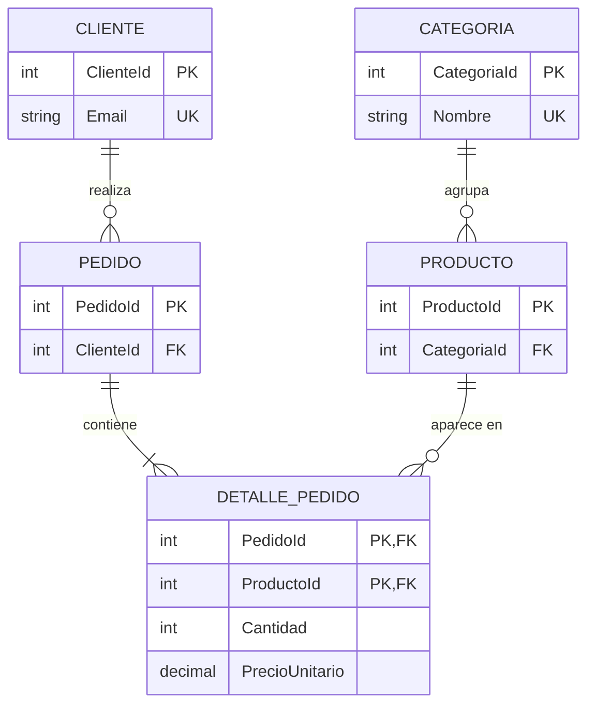

# Del modelo ER a tablas

## En una frase

Pasar del modelo entidad-relación a tablas es aplicar un conjunto de **reglas fijas** (cada entidad es una tabla, cada atributo multivaluado es otra tabla, cada 1:N es una clave foránea, cada N:M es una tabla intermedia) que convierten el diagrama conceptual en el modelo lógico, sin improvisar.

-----

## Antes de empezar

Conviene que ya sepas:

* Tipos de atributos y entidades débiles, de [Modelo entidad-relación](02-Modelo%20entidad-relación.md).
* Cómo se implementa cada cardinalidad, de [Cardinalidad y relaciones](03-Cardinalidad%20y%20relaciones.md).

Palabras nuevas (también están en el [Glosario](Glosario.md)):

* **Mapeo (traducción) ER-relacional:** el procedimiento que convierte entidades, atributos y relaciones en tablas, columnas y claves.
* **Modelo lógico:** el resultado: tablas con sus columnas, claves primarias y foráneas, todavía sin tipos concretos de un motor.
* **Columna calculada (computed column):** columna cuyo valor se calcula a partir de otras columnas de la misma fila.
* **Relación ternaria:** relación entre tres entidades.

-----

## El problema

Dos personas reciben el mismo diagrama ER de la tienda y producen dos esquemas distintos:

* Una guarda los teléfonos del cliente en `Telefono1`, `Telefono2`, `Telefono3`.
* La otra pone la dirección en una sola columna `Direccion NVARCHAR(300)`.
* Una agrega `Pedido.Total`; la otra no.
* Una crea `DetallePedido` con una clave sustituta y sin `UNIQUE`; la otra, con clave compuesta.

Ninguna de las dos "se equivocó" según su criterio, pero las dos bases van a comportarse distinto ante el mismo requisito. El diagrama ER ya contenía la información para decidir cada caso: los teléfonos eran un atributo **multivaluado**; la dirección, **compuesta**; el total, **derivado**; el detalle, una relación N:M. Lo que faltaba era aplicar las reglas de traducción.

-----

## Cómo funciona

### Las reglas de traducción

| # | Elemento del modelo ER | Se convierte en |
| --- | --- | --- |
| 1 | Entidad fuerte | Una tabla, con su identificador como clave (natural o sustituta) |
| 2 | Atributo simple | Una columna |
| 3 | Atributo compuesto | Una columna por cada parte |
| 4 | Atributo multivaluado | Una tabla nueva: clave de la entidad + el valor |
| 5 | Atributo derivado | No se guarda; se calcula en una consulta, una vista o una columna calculada |
| 6 | Atributo opcional | Una columna `NULL` |
| 7 | Entidad débil | Una tabla cuya clave incluye la clave de la propietaria (y FK hacia ella) |
| 8 | Relación 1:N | FK en la tabla del lado N |
| 9 | Relación 1:1 | FK con `UNIQUE` (o PK compartida) en la tabla dependiente |
| 10 | Relación N:M | Tabla intermedia con FK a ambas; clave compuesta por las dos FK |
| 11 | Atributos de una relación | Columnas en la tabla que implementa la relación (en la intermedia, si es N:M) |
| 12 | Relación ternaria | Tabla con tres FK |

### Reglas 1 y 2: entidades y atributos simples

```text
Entidad Categoría { Nombre (identificador) }

→ Categoria(CategoriaId PK, Nombre UNIQUE)
```

El identificador del modelo ER (`Nombre`) se convierte en clave alternativa (`UNIQUE`) y se agrega una clave sustituta como primaria, por las razones de [Claves primarias](../01-fundamentos/04-Claves%20primarias.md). Si el identificador fuera corto y estable (un código ISO), podría ser la primaria directamente.

### Regla 3: atributos compuestos

Una dirección tiene partes con significado propio: calle, número, distrito, ciudad. Si se consultan o se validan por separado ("clientes de Arequipa"), cada parte es una columna:

```text
Cliente { Dirección = (Calle, Numero, Distrito, Ciudad) }

→ Cliente(..., Calle, Numero, Distrito, Ciudad)
```

Si la dirección solo se imprime en una etiqueta y nunca se consulta por partes, una sola columna puede alcanzar. La regla para decidir: **¿alguna vez se va a filtrar, agrupar o validar por una de las partes?**

### Regla 4: atributos multivaluados

Un cliente puede tener varios teléfonos. Nunca columnas repetidas (`Telefono1`, `Telefono2`): una tabla con una fila por valor.

```text
Cliente { Teléfonos (multivaluado) }

→ Cliente(ClienteId PK, ...)
→ ClienteTelefono(ClienteId PK FK, Telefono PK)
```

```sql
CREATE TABLE dbo.ClienteTelefono (
    ClienteId INT         NOT NULL,
    Telefono  VARCHAR(20) NOT NULL,
    Tipo      VARCHAR(10) NOT NULL,   -- 'Móvil', 'Casa', 'Trabajo'
    CONSTRAINT PK_ClienteTelefono PRIMARY KEY (ClienteId, Telefono),
    CONSTRAINT FK_ClienteTelefono_Cliente FOREIGN KEY (ClienteId)
        REFERENCES dbo.Cliente (ClienteId) ON DELETE CASCADE
);
```

Con esta tabla, buscar a quién pertenece un teléfono es un `WHERE Telefono = ...`, cada número se valida por separado y un cliente puede tener uno o veinte. El `ON DELETE CASCADE` tiene sentido: los teléfonos son parte del cliente.

### Regla 5: atributos derivados

El total de un pedido es la suma de sus detalles. Si se guarda en `Pedido.Total`, hay dos fuentes de verdad que pueden dejar de coincidir. Las opciones, de mejor a peor por defecto:

1. **Calcularlo en la consulta:**

   ```sql
   SELECT PedidoId, SUM(Cantidad * PrecioUnitario) AS Total
   FROM dbo.DetallePedido
   GROUP BY PedidoId;
   ```

2. **Una vista**, para no repetir el cálculo en cada consulta.

3. **Una columna calculada**, cuando el derivado sale de columnas **de la misma fila**:

   ```sql
   ALTER TABLE dbo.DetallePedido
       ADD Subtotal AS (Cantidad * PrecioUnitario) PERSISTED;
   ```

   El motor la mantiene siempre correcta: no se puede escribir a mano. `PERSISTED` la guarda en disco (y permite indexarla); sin `PERSISTED`, se calcula al leer.

4. **Guardarlo y mantenerlo**, solo si hay un problema de rendimiento medido: es desnormalización (ver [Desnormalización](08-Desnormalización.md)).

La edad, calculada a partir de la fecha de nacimiento, es el caso clásico: guardar `Edad` garantiza que el dato quede desactualizado al año siguiente.

### Regla 7: entidades débiles

```text
Edificio { Código (identificador) }
Aula (débil) { Número } — pertenece a — Edificio

→ Edificio(CodigoEdificio PK, ...)
→ Aula(CodigoEdificio PK FK, NumeroAula PK, Capacidad)
```

La clave primaria de `Aula` es compuesta: el aula "101" solo se identifica junto con su edificio.

### Reglas 8 a 11: relaciones

Ya se vieron en [Cardinalidad y relaciones](03-Cardinalidad%20y%20relaciones.md). Lo nuevo aquí es la regla 11: **los atributos de una relación viajan con ella**. En una 1:N, a la tabla del lado N; en una N:M, a la tabla intermedia. La cantidad y el precio pagado de "pedido contiene producto" terminan en `DetallePedido`.

### Regla 12: relaciones ternarias

"Un profesor dicta una materia en un aula, en un horario." Si las tres entidades participan a la vez en un mismo hecho, la relación es una tabla con las tres FK:

```text
→ Asignacion(ProfesorId FK, MateriaId FK, AulaId FK, Horario, ...)
```

La clave primaria depende de las reglas: si un aula solo puede tener una asignación por horario, `UNIQUE (AulaId, Horario)`; si un profesor no puede estar en dos aulas a la vez, `UNIQUE (ProfesorId, Horario)`. Cada regla de negocio se convierte en una restricción.

-----

## Ejemplo completo

Traducir el modelo ER de la tienda, de [Modelo entidad-relación](02-Modelo%20entidad-relación.md), aplicando las reglas paso a paso:

| Elemento ER | Regla | Resultado |
| --- | --- | --- |
| Entidad Cliente | 1 | `Cliente(ClienteId PK, ...)` |
| Email (identificador) | 1 | `Email UNIQUE` |
| Ciudad (opcional) | 6 | `Ciudad NULL` |
| Entidad Categoría | 1 | `Categoria(CategoriaId PK, Nombre UNIQUE)` |
| Entidad Producto | 1 | `Producto(ProductoId PK, Nombre, Precio, Stock, Activo)` |
| Entidad Pedido | 1 | `Pedido(PedidoId PK, FechaPedido, Estado)` |
| Pedido.Total (derivado) | 5 | No se guarda |
| Cliente realiza Pedido (1:N) | 8 | `Pedido.ClienteId FK NOT NULL` |
| Categoría agrupa Producto (1:N) | 8 | `Producto.CategoriaId FK NOT NULL` |
| Pedido contiene Producto (N:M) | 10 | Tabla `DetallePedido(PedidoId, ProductoId)` |
| Cantidad, PrecioUnitario (de la relación) | 11 | Columnas de `DetallePedido` |

Modelo lógico resultante:

```text
Cliente       (ClienteId PK, Nombre, Email UQ, Ciudad NULL, FechaRegistro)
Categoria     (CategoriaId PK, Nombre UQ)
Producto      (ProductoId PK, CategoriaId FK → Categoria, Nombre, Precio, Stock, Activo)
Pedido        (PedidoId PK, ClienteId FK → Cliente, FechaPedido, Estado)
DetallePedido (PedidoId PK FK → Pedido, ProductoId PK FK → Producto, Cantidad, PrecioUnitario)
```



Qué cambió respecto del diagrama conceptual:

* **Aparecieron las claves sustitutas** (`ClienteId`, `PedidoId`...) y las claves foráneas.
* **La relación N:M se convirtió en una entidad:** `DETALLE_PEDIDO`, con las dos relaciones 1:N en las que se descompone.
* **El total desapareció:** se calcula. Para mostrarlo, una consulta con los datos de ejemplo:

```sql
SELECT p.PedidoId, c.Nombre AS Cliente, SUM(d.Cantidad * d.PrecioUnitario) AS Total
FROM dbo.Pedido AS p
JOIN dbo.Cliente AS c ON c.ClienteId = p.ClienteId
JOIN dbo.DetallePedido AS d ON d.PedidoId = p.PedidoId
GROUP BY p.PedidoId, c.Nombre
ORDER BY p.PedidoId;
```

| PedidoId | Cliente | Total |
| --- | --- | --- |
| 1 | Ana Torres | 211.00 |
| 2 | Luis Ramos | 849.90 |
| 3 | Ana Torres | 265.00 |
| 4 | María Quispe | 210.00 |
| 5 | Jorge Díaz | 140.50 |

Falta validar que no haya redundancia (normalización) y tomar las decisiones físicas (tipos, índices). Lo primero se hace en las dos lecciones siguientes; lo segundo ya está resuelto en el [esquema de ejemplo](../00-Esquema%20de%20ejemplo.md).

-----

## Errores comunes

**1. Columnas numeradas para un atributo multivaluado.**
Qué pasa: `Telefono1`, `Telefono2`, `Telefono3`. El cliente con cuatro teléfonos no cabe, buscar un número exige tres condiciones con `OR` y la mayoría de las celdas están vacías.
Por qué: se evita "otra tabla".
Arreglo: regla 4, una tabla con una fila por valor.

**2. Guardar atributos derivados "para no calcular".**
Qué pasa: `Pedido.Total` desactualizado tras modificar un detalle; `Cliente.Edad` incorrecta al año siguiente.
Por qué: se guarda el resultado en lugar de calcularlo.
Arreglo: consulta, vista o columna calculada. Guardarlo es una desnormalización que se justifica con una medición.

**3. Dirección en una sola columna cuando se consulta por partes.**
Qué pasa: "clientes de Arequipa" termina en `WHERE Direccion LIKE '%Arequipa%'`, que también encuentra "Av. Arequipa 123, Lima".
Por qué: el atributo compuesto no se dividió.
Arreglo: regla 3, una columna por cada parte que se consulte o valide.

**4. Atributos de la relación en la entidad equivocada.**
Qué pasa: `Producto.Cantidad` (¿la cantidad de qué pedido?) o `Pedido.PrecioUnitario` (¿de qué producto?).
Por qué: se olvida que el dato depende de la combinación.
Arreglo: regla 11, el atributo va en la tabla que implementa la relación.

**5. Entidad débil con clave sustituta y sin `UNIQUE`.**
Qué pasa: dos "aula 101" en el mismo edificio.
Por qué: se agrega un `AulaId IDENTITY` y se pierde la regla de identificación.
Arreglo: clave compuesta `(CodigoEdificio, NumeroAula)`, o sustituta + `UNIQUE (CodigoEdificio, NumeroAula)`.

-----

## Según el motor

Las reglas de traducción son las mismas en los tres motores; cambia la sintaxis de las columnas calculadas y de algunos tipos:

| Concepto | SQL Server | PostgreSQL | MySQL |
| --- | --- | --- | --- |
| Columna calculada guardada | `Col AS (expr) PERSISTED` | `col tipo GENERATED ALWAYS AS (expr) STORED` (desde la 12) | `col tipo AS (expr) STORED` (desde 5.7) |
| Columna calculada al leer | `Col AS (expr)` | `GENERATED ALWAYS AS (expr) VIRTUAL` (desde la 18, y es el valor por defecto) | `col tipo AS (expr) VIRTUAL` |
| Atributo multivaluado sin tabla aparte | No | Arreglos (`text[]`) | JSON |
| Atributo compuesto como un solo tipo | No | Tipos compuestos (`CREATE TYPE ... AS (...)`) | No |

PostgreSQL permite resolver los atributos multivaluados y compuestos con arreglos y tipos propios. Es cómodo para datos que se leen siempre juntos y nunca se consultan por elemento, pero se pierde la integridad referencial y las restricciones por valor. La tabla aparte sigue siendo la opción por defecto.

### En MongoDB

Las reglas cambian casi por completo, porque el documento admite estructuras anidadas:

| Elemento ER | En MongoDB |
| --- | --- |
| Atributo compuesto | Subdocumento: `direccion: { calle, numero, ciudad }` |
| Atributo multivaluado | Arreglo: `telefonos: ["999...", "988..."]` |
| Entidad débil | Subdocumento o arreglo dentro de la propietaria |
| 1:N con pocos hijos que se leen juntos | Arreglo embebido (los detalles en el pedido) |
| 1:N con muchos hijos o con vida propia | Colección aparte con referencia |
| Derivado | Se suele guardar (el total del pedido), porque no hay joins baratos; se actualiza en la misma operación |

-----

## Cuándo sí y cuándo no

**Aplica las reglas de forma sistemática cuando:**

* Pasas del diagrama conceptual a tablas: cada elemento del diagrama debe terminar en exactamente una decisión de la tabla de reglas.

**Ten en cuenta:**

* Las reglas producen un modelo **lógico**. Todavía hay que validarlo con la normalización y completarlo con las decisiones físicas.
* La regla 3 (atributos compuestos) depende del uso: dividir una dirección en ocho columnas que nunca se consultan por separado es complejidad sin beneficio.

**Herramientas que ayudan:**

* Una tabla de trazabilidad "elemento ER → regla → resultado", como la del ejemplo completo, sirve de checklist: si un elemento del diagrama no aparece, falta algo.

-----

## Resumen en 5 líneas

1. Entidad → tabla; atributo simple → columna; opcional → `NULL`; identificador → PK o `UNIQUE`.
2. Compuesto → una columna por parte que se consulte; multivaluado → tabla aparte con una fila por valor.
3. Derivado → no se guarda: consulta, vista o columna calculada.
4. Entidad débil → clave compuesta que incluye la de su propietaria.
5. 1:N → FK en el lado N; N:M → tabla intermedia; los atributos de la relación viajan con ella.

-----

## Para profundizar

<details>
<summary>Columnas calculadas: deterministas, persistidas e indexadas</summary>

Una columna calculada solo puede ser `PERSISTED` (y indexada) si su expresión es **determinista**: devuelve siempre el mismo resultado para los mismos valores de entrada. `Cantidad * PrecioUnitario` lo es; una expresión con `GETDATE()` no, porque cambia con el tiempo. Por eso la edad **no** se puede guardar como columna calculada persistida, y se calcula en la consulta:

```sql
SELECT Nombre,
       DATEDIFF(YEAR, FechaNacimiento, GETDATE())
         - CASE WHEN DATEADD(YEAR, DATEDIFF(YEAR, FechaNacimiento, GETDATE()), FechaNacimiento) > GETDATE()
                THEN 1 ELSE 0 END AS Edad
FROM dbo.Paciente;
```

El `CASE` corrige que `DATEDIFF(YEAR, ...)` cuenta los cambios de año, no los años cumplidos.

</details>

<details>
<summary>¿Por qué no guardar el total del pedido en la tabla Pedido?</summary>

Hay razones legítimas para hacerlo: el total de una factura emitida es un hecho legal que no debe cambiar aunque cambien los detalles, y en listados de millones de pedidos sumar los detalles cada vez es caro. Pero son decisiones **posteriores** al modelo lógico: la primera es una regla de negocio (el documento emitido se congela) y la segunda, una optimización física. En el modelo lógico el total es derivado, y se registra como tal para que cualquier copia guardada sea una decisión consciente.

</details>

-----

## En entrevista

### Respuesta corta (junior)

Cada entidad del diagrama se convierte en una tabla con su clave primaria. Las relaciones uno a muchos se implementan con una clave foránea en la tabla del lado "muchos", y las de muchos a muchos con una tabla intermedia. Si un atributo puede tener varios valores, como los teléfonos, va en una tabla aparte.

### Respuesta ampliada (semi-senior)

Aplico reglas de traducción sistemáticas. Las entidades fuertes son tablas con una clave sustituta, y el identificador natural queda como `UNIQUE`; las débiles llevan una clave compuesta que incluye la de su propietaria. Los atributos compuestos se dividen en columnas cuando se van a consultar por partes; los multivaluados van a una tabla con una fila por valor, nunca a columnas numeradas; y los derivados no se guardan, sino que se calculan en consultas, vistas o columnas calculadas, que solo se pueden persistir si la expresión es determinista. Las 1:N son FK en el lado N, las 1:1 son FK con `UNIQUE` o PK compartida, y las N:M son tablas intermedias que reciben los atributos de la relación. El resultado es un modelo lógico que después valido con normalización, y sobre el que tomo las decisiones físicas.

### Preguntas frecuentes de seguimiento

**1. ¿Cómo implementas un atributo multivaluado?**
Con una tabla aparte que tiene la clave de la entidad y el valor, una fila por valor, con clave compuesta por ambos.

**2. ¿Guardarías el total del pedido?**
En el modelo lógico, no: es derivado. Lo guardaría por una regla de negocio (congelar un documento emitido) o por un problema de rendimiento medido, sabiendo que hay que mantenerlo sincronizado.

**3. ¿Qué es una columna calculada?**
Una columna cuyo valor se calcula a partir de otras de la misma fila. Con `PERSISTED`, se guarda y se puede indexar, siempre que la expresión sea determinista.

**4. ¿Dónde van los atributos de una relación N:M?**
En la tabla intermedia, porque dependen de la combinación de las dos entidades.

-----

## Práctica

**Ejercicio 1.** Traduce a un modelo lógico (tablas, PK, FK, `UNIQUE`) el modelo de la clínica de la práctica de [Modelo entidad-relación](02-Modelo%20entidad-relación.md): Médico, Especialidad (N:M con Médico), Paciente (con DNI, nombre, fecha de nacimiento, teléfonos y edad), Cita (de un paciente con un médico, con fecha y hora y un diagnóstico opcional).

<details>
<summary>Solución</summary>

```text
Medico             (MedicoId PK, Nombre, NumeroColegiatura UQ)
Especialidad       (EspecialidadId PK, Nombre UQ)
MedicoEspecialidad (MedicoId PK FK → Medico, EspecialidadId PK FK → Especialidad)
Paciente           (PacienteId PK, Dni UQ, Nombre, FechaNacimiento)
PacienteTelefono   (PacienteId PK FK → Paciente, Telefono PK)
Cita               (CitaId PK, PacienteId FK → Paciente, MedicoId FK → Medico,
                    FechaHora, Diagnostico NULL)
```

Reglas aplicadas:

* **Edad:** derivada, no se guarda (regla 5).
* **Teléfonos:** multivaluado, tabla aparte (regla 4).
* **Médico – Especialidad:** N:M, tabla intermedia (regla 10).
* **Cita:** se modela como entidad con clave sustituta, porque el mismo paciente puede tener varias citas con el mismo médico. Una restricción útil: `UNIQUE (MedicoId, FechaHora)`, para que un médico no tenga dos citas en el mismo horario.
* **Diagnóstico:** opcional hasta que ocurre la cita (regla 6).

</details>

**Ejercicio 2.** Agrega a `DetallePedido` una columna calculada con el subtotal de la línea, y escribe una consulta que liste las líneas del pedido 3 con su subtotal.

<details>
<summary>Solución</summary>

```sql
ALTER TABLE dbo.DetallePedido
    ADD Subtotal AS (Cantidad * PrecioUnitario) PERSISTED;

SELECT d.PedidoId, p.Nombre, d.Cantidad, d.PrecioUnitario, d.Subtotal
FROM dbo.DetallePedido AS d
JOIN dbo.Producto AS p ON p.ProductoId = d.ProductoId
WHERE d.PedidoId = 3;
```

| PedidoId | Nombre | Cantidad | PrecioUnitario | Subtotal |
| --- | --- | --- | --- | --- |
| 3 | Lámpara de escritorio | 1 | 75.00 | 75.00 |
| 3 | Clean Code | 2 | 95.00 | 190.00 |

Intentar escribir el subtotal a mano (`UPDATE dbo.DetallePedido SET Subtotal = 0`) falla: el motor es el único que lo calcula, así que nunca queda desactualizado. (El orden de las filas puede variar sin `ORDER BY`.)

</details>

-----

## Siguiente lección

[Dependencias funcionales](05-Dependencias%20funcionales.md)
